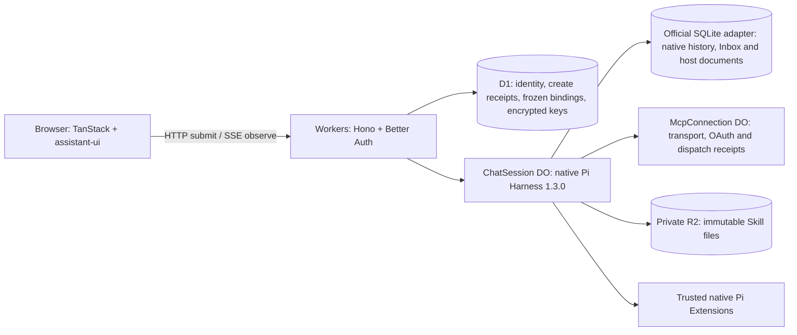

# MkHarness

**Build Agent apps with durable execution and extensible UI.**

[English](README.md) · [Chinese](README.zh-CN.md)

MkHarness is an open-source application template for building your own Agent product. It combines a streaming chat interface, persistent execution, and extensions for tools and interactive results, using **TanStack, Cloudflare, Pi, and assistant-ui**.

Sign in with Google, add your API key in the UI, and deploy the same application to Cloudflare.

[Quick start](#quick-start) · [Features](#features) · [Extensions](#extend-mkharness) · [Deployment](#deploy-to-cloudflare) · [FAQ](#faq) · [MIT License](LICENSE)

The native Pi replacement uses a separate fresh environment. Its public-domain cutover and real-provider acceptance are still pending; the earlier hosted example does not validate this runtime.

## Quick start

You need **Node.js 24**, **pnpm 11.17.0**, and a supported model API key. Local development requires Google OAuth credentials but no Cloudflare account.

```sh
git clone https://github.com/Yukee-798/mkharness.git
cd mkharness
pnpm install --frozen-lockfile
cp .dev.vars.example .dev.vars
pnpm setup
pnpm dev
```

Set `GOOGLE_CLIENT_ID` and `GOOGLE_CLIENT_SECRET` in `.dev.vars`, with callback `http://localhost:5173/api/auth/callback/google`. Restart the server after editing secrets.

Open **http://localhost:5173** and sign in with Google:

1. Select a model in the composer.
2. Open the account menu at the bottom of the sidebar → **Settings → Models & API Key**. Configure **Model name**, **Base URL** and **API Key**, then click **Save configuration**.
3. Send your first message.

The interface defaults to English. Switch to Chinese in **Settings → General → Language**, and choose **Light**, **Dark**, or **System** in **Appearance**. These preferences are remembered in this browser; the default theme follows your system.

Try asking a question, requesting an interactive plan, or reading a public web page. Web search requires a separate search key; the `describe_text` sample is opt-in.

> Keys entered through the UI are sent to your deployment and encrypted on the server for background execution and recovery. Use your own deployment or one you trust. Saving a key does not test the connection; the first model request uses it.

`pnpm setup` generates missing local authentication and encryption secrets and applies the native D1 migrations, starting with `migrations/0001_initial.sql`. Keep `.dev.vars` across restarts; Git ignores it. Native Pi development data lives in `.wrangler/native-state`, separate from earlier local installations. Setup accepts an empty database or the known native migration chain and refuses unrelated older schemas; it never imports accounts, chats, credentials, MCP connections or Skills. Migration `0002_google_accounts.sql` revokes previous browser-only sessions and drops their identity flag while retaining users and owned data. Apply it before deploying Google-only authentication. Run `node scripts/setup.mjs --check` to check local readiness without changing secrets or applying migrations. Use `localhost` consistently rather than switching between it and `127.0.0.1`. The interface supports English and Chinese.

## Features

- **An Agent workbench.** A unified collapsible sidebar for Agent, scheduled tasks and the plugin marketplace, with developer-defined right panels. OpenUI is the default panel; scheduling and marketplace pages are placeholders. Desktop panels resize, maximize and restore; mobile uses a full-screen sheet.
- **A working chat app.** Streaming responses, reasoning and tool activity, model and thinking-level selection, conversation history, and reply/tool timing. Built with assistant-ui, shadcn/ui, and Tailwind CSS.
- **Image attachments.** Preview and remove PNG, JPEG, WebP, or GIF images using assistant-ui; send images with text or on their own to an image-capable model. Up to 4 images totaling 512 KiB per message, retained in Pi history for retries and recovery.
- **A durable, editable queue.** Pending messages survive refresh. Edit withdraws an unstarted message and restores its text and images to the composer; Steer joins the current work at a native Pi boundary; Remove withdraws one pending message. Already-started tasks cannot be withdrawn through queue controls. Pi remains the only queue authority.
- **Durable Agent execution.** Each chat runs in a `ChatSession` Durable Object with one native Pi Durable 1.3.0 Harness and the official SQLite adapter. Pi owns submissions, Inbox, history and task recovery. Closing the browser detaches observation; Stop is a separate action. Deletion returns `202` after a durable tombstone and cleanup alarm, hides the chat, and erases its content after runtime shutdown. D1 retains a minimal create/deletion receipt so delayed calls cannot recreate it.
- **Extensions on both sides.** Add native Pi tools, prompts, and hooks on the server. Register assistant-ui Toolkits, tool-title decorations, message footers, and workbench panels in the browser.
- **Interactive generated UI.** The optional OpenUI extension renders forms, tables, and charts, saves inputs, and performs bounded QuickJS calculations.
- **Remote integrations.** User-added remote MCP connections with native SDK OAuth, deployment-configured MCP tools, static Skills, and an async-service example with submit/query/cancel and persisted recovery references.
- **Google accounts and personal keys.** Better Auth Google sign-in scopes data to each account. Users configure their own model name, Base URL and API Key; a deployment default key is optional.

Use this foundation for research assistants, data workflows, or creative Agents that call your services. MkHarness provides application and execution infrastructure; product-specific tools, image/video services, billing, and subscriptions are yours to add.

## Extend MkHarness

See [source architecture](ARCHITECTURE.md) for current ownership and runtime contracts. The [historical engineering review](ENGINEERING_REVIEW.md) records the implementation before the native replacement and is not a current architecture or acceptance report.

Extensions are trusted code that you review and ship with your application. Server capabilities and browser presentation have separate static registration points, so a tool can have a custom renderer without adding tool-specific branches to core chat logic.

| Add or customize                                           | Start here                                                                                                              |
| ---------------------------------------------------------- | ----------------------------------------------------------------------------------------------------------------------- |
| Agent tools, prompt sections, hooks                        | [`src/extensions/server.ts`](src/extensions/server.ts) — native Pi Extensions                                           |
| Tool renderers, title decorations, reply/composer footers  | [`src/extensions/browser.ts`](src/extensions/browser.ts) — assistant-ui Toolkits and browser contributions              |
| Generated UI, resources, input state, continuation actions | [`src/extensions/openui/`](src/extensions/openui/) — a complete optional extension                                      |
| Native Skills data bridge                                  | [`src/server/skills/native.ts`](src/server/skills/native.ts)                                                            |
| Deployment MCP tools                                       | [`src/server/mcp/deployment.ts`](src/server/mcp/deployment.ts) — `MCP_SERVERS` configuration                            |
| An async service                                           | [`src/extensions/async-example/`](src/extensions/async-example/) — adapt to your service's submit/query/cancel contract |

Manage all extension switches in [`extensions.config.ts`](extensions.config.ts). For a small example, set `example.enabled` to `true` there. Its [server tool, prompt section and hook](src/extensions/example/server.ts) and [browser renderer](src/extensions/example/browser.tsx) live together in `src/extensions/example/` and are disabled by default. The [timing extension](src/extensions/timing/) demonstrates decorating existing tools and replies.

For custom workbench panels, export `panels` from your reviewed browser extension using `defineWorkbenchPanel`. The host handles target validation, selection, hide/restore, responsive layout and account-scoped reference persistence. See the [current panel Interface and example](WORKBENCH_DESIGN.md#13-首期实际实现与开发者接入) and the [OpenUI adapter](src/extensions/openui/WorkbenchPanel.tsx). Browser or cloud desktop providers own their connection lifecycle; the template ships the OpenUI preview adapter.

Successful web reads and searches populate Sources cards from committed Pi results. The reply extension adds native assistant-ui follow-up buttons and Regenerate to the action bar. Follow-ups are localized common prompts and require no background model call. Regenerate submits a new operation referring to the original committed input, including its form context; the original answer stays in history. It uses current model settings and does not authorize replay of an unknown remote side effect.

Set `openui.enabled` to `false` to disable OpenUI's tools, prompts, resources, actions, UI and computation together; set `'skills-example'.enabled` to `true` to try the static Skill example. `timing`, `web`, `reply`, `async-example`, `example`, and the host MCP integration use the same configuration file. `openui.inspect` controls the optional developer inspector. Rebuild/redeploy after changing deployment configuration, or restart local development. The former per-extension environment switches are no longer used. Web search is registered only when `TAVILY_API_KEY` is configured; reading web pages needs no search key.

OpenUI's form catalog includes sliders (single value or range), switches, dates, selects, checkboxes, and text fields. `Progress` uses shadcn/ui to display measured or computed progress. For example, the following document updates the progress bar locally as the slider changes; editing does not call the Agent:

```text
$amount = [40]
root = Stack([
  Slider("amount", "continuous", 0, 100, 1, null, "Amount", null, $amount),
  Progress($amount[0], "Target", 100, true)
])
```

Use two slider values for a range, such as `[20, 80]`. Use `Progress(null, "Waiting for data")` when progress is unknown; it does not track background Agent tasks automatically.

See the [server contracts](src/server/extensions/contributions.ts), [browser contracts](src/browser/extensions/extensions.ts), and [.dev.vars.example](.dev.vars.example) for the available interfaces and configuration. Runtime plugin installation and marketplace compatibility are not included.

The async-service sample is assembled as the `async-example` contribution in the same server and browser registration lists. Set `ASYNC_SERVICE_URL` to install its native tools and tasks; the contribution can still display and guard previously saved outcomes when the service is unconfigured. Its directory owns the provider contract, retry/recheck authorization, native task recovery and progress cards. To omit the sample entirely, set `'async-example'.enabled` to `false`; basic chat, history, Stop and MCP remain independent.

The host offers two execution boundaries (`beforeModel` and idle `beforeSubmit`), declared native document projections (`stateDocuments` + `projectConversation`), per-entry `projectHistory` annotations, and a browser `composerFooter` slot. Execution stays in Pi Durable. Retry/recheck requests use `extension_action` with `extensionId: "async-example"` and a validated `{ taskId }` payload. The sample owns its provider-specific intent document and reconciliation policy. MCP owns separate connection receipts and does not read the sample's documents.

Generic finite-JSON validation, size checks and canonical equality live in `src/shared/json.ts`, which has no compute-engine imports. QuickJS, its budgets, browser Worker, WASM bindings and build integration belong to `src/extensions/openui/`. A disabled OpenUI build excludes the extension's browser/server entries and their computation assets; core chat, MCP, requests and JSON utilities never import QuickJS. Dependencies remain listed in the template's package manifest for builds that enable OpenUI. Service endpoints, API keys and MCP connection definitions remain server bindings; they configure a connection rather than enable an extension. Disabling MCP prevents connections and tool registration, while persisted unknown-outcome protection remains in the host.

## Custom remote MCP connections

Open **Settings → Connections → Add connection**, enter a name and a public HTTPS Streamable HTTP endpoint (for example, `https://mcp.notion.com/mcp`), and connect. Automatic OAuth uses the Cloudflare Agents SDK for protected-resource/authorization-server discovery, client registration, PKCE, callback validation, token exchange and refresh. HTTPS deployments publish client metadata at `/api/mcp/client-metadata`; servers without dynamic registration or client metadata support can use the advanced pre-registered Client ID/secret fields. OAuth compatibility depends on the server; arbitrary nonstandard provider flows are not bundled. Connections belong to the signed-in account within each deployment.

Newly discovered tools default to **Ask every time**. Each tool can be disabled or allowed automatically. New chats freeze enabled tool definitions; permission restrictions and disconnects apply again immediately before dispatch. Tool or authorization changes require a new chat. Pending confirmations appear beside their tool invocation and survive refresh; Reject and Stop prevent undispatched operations. An interrupted dispatched call is marked **outcome unknown** and is never resent automatically. That connection remains blocked until externally reconciled; this version has no manual outcome-resolution action. Disconnecting erases locally stored tokens; revoke the application's authorization at the provider separately if needed.

The configuration UI reuses `@assistant-ui/react-mcp` primitives with a server-backed presentation adapter. Approval cards reuse the assistant-ui registry component. Connections, OAuth credentials and tool execution remain on the server; the browser does not install the default MCP manager, persist connection credentials or register frontend tools. Approval decisions update the existing Pi task through the extension control endpoint.

`mcp.enabled` controls all MCP integration; `mcp.custom` controls user-managed connections separately. The fresh-install D1 baseline includes the connection catalog. `MCP_CONNECTIONS` binds the `McpConnection` SQLite Durable Object declared in Wrangler's `exports`. Create connections again in the new environment; OAuth grants and tokens are not imported. `CREDENTIAL_ENCRYPTION_KEY` encrypts Bearer credentials, OAuth client secrets and tokens in each connection's DO. Keep that key stable; credentials never enter conversation bindings or public projections.

The module boundaries are:

- `src/server/mcp/connections/`: user and deployment connection scopes, encrypted connection state, native SDK transport, durable dispatch receipts, HTTP routes and endpoint policy.
- `src/extensions/mcp/`: native Pi tools/tasks/documents for confirmation and interruption recovery, plus browser presentation through the existing extension slot. Confirmation decisions use the generic extension control endpoint and never start a second model run.
- `src/server/mcp/deployment.ts`: deployment-managed `MCP_SERVERS`, frozen tool definitions and native tools/tasks that call the independent connection DO.

The first version supports public HTTPS Streamable HTTP endpoints, bounded JSON tool schemas, and text/structured-JSON results. Unsupported schemas are visible but cannot be enabled. It does not execute local stdio commands, fetch remote schema references, or implement MCP Apps, sampling, resources or prompts as user-facing capabilities. Private/reserved destinations and HTTP redirects are rejected for both MCP and OAuth requests, with DNS preflight, timeouts and response limits. DNS preflight is defense in depth; deployments needing strict DNS-rebinding protection must also enforce a network egress boundary.

## User skills

Open **Settings → Skills → Import skill** and upload a Markdown `SKILL.md` or a ZIP containing one skill directory. Review the instructions, file list and compatibility notes before saving. A skill needs YAML frontmatter with `name` and `description` plus a nonempty Markdown body. The optional parent directory must match `name`. Reference files and templates are supported; scripts are stored/read as text and are never executed. Binary assets are retained but unavailable to the agent in this version. Skill content does not authorize tools or provide credentials.

Enabled skills are selected by default for a new chat; manage them in Settings → Skills. The server pins immutable content versions when creating the chat. Uploading a new version, disabling or removing a library entry affects future chats; older chats retain their bound versions and previously loaded instructions. Removal is a library operation, not erasure of historical versions. At most 32 library entries and 8 selected skills are accepted; uploads are limited to 1 MiB compressed, 2 MiB expanded, 128 KiB per file, and 64 files per package.

The host's `nativeSkills` bridge in `src/server/skills/native.ts` registers native Pi `activate_skill` and `read_skill_resource` tools with the 1.3.0 `output` result contract. Frozen directory metadata enters the prompt first; activation lazily loads instructions, and resource reads fetch the selected private R2 object on demand. Tool results enter ordinary Pi history. Source adapters check ownership, immutable versions, paths, sizes and content hashes. Skill activity and versions are shown in tool records; manage Skills in Settings. Skills grant no tool permissions and execute no scripts.

`skills.enabled` in `extensions.config.ts` controls the feature. The fresh-install D1 baseline includes Skills metadata; configure a **private** R2 bucket as `SKILL_FILES`. D1 stores ownership, revisions, version metadata and conversation bindings; R2 stores immutable files, checked against their content hashes on reads. Provision the bucket configured for the intended Wrangler environment, for example `pnpm exec wrangler r2 bucket create mkharness-native-skills` for production. Keep public bucket access disabled. This is an additional resource, separate from the D1 baseline. Import or publish Skills again through the product in the new environment. The `skills-example` remains optional; if enabled together, both source kinds share one native Skills extension.

- `src/server/skills/`: bounded import validation, D1/R2 catalog, versioned sources and authenticated management routes. Frontmatter uses the YAML library also used by the SDK; importing the SDK's broad parser entry would require its optional script-runtime dependencies.
- `src/extensions/skills/`: native Pi integration, result projection and browser selection/presentation. User packages remain data, not executable extension modules.

## Deploy to Cloudflare

The application runs on **Workers + D1 + SQLite-backed Durable Objects + private R2**. The native Pi runtime requires a new empty environment: a new Worker, D1 database, `ChatSession` and `McpConnection` namespaces, and private Skills bucket. Accounts, chats, model keys, MCP grants and Skills must be configured again. The baseline is not an upgrade for an existing deployment.

### 1. Create resources

After installing dependencies:

```sh
pnpm exec wrangler login
pnpm exec wrangler d1 create mkharness-native
pnpm exec wrangler r2 bucket create mkharness-native-skills
```

Edit **`env.production`** in [`wrangler.jsonc`](wrangler.jsonc) before building:

| Setting                                         | Value                                                                                   |
| ----------------------------------------------- | --------------------------------------------------------------------------------------- |
| `name`                                          | `mkharness-native`, or another unused Worker name                                       |
| `d1_databases[0].database_name` / `database_id` | Name and ID returned by the new `d1 create`                                             |
| `r2_buckets[0].bucket_name`                     | The new private bucket name                                                             |
| `vars.APP_URL`                                  | Your deployment's exact origin; change `template.mkharness.com` for your installation   |
| `vars.ALLOW_SERVER_MODEL_KEY`                   | `0` for your own installation; the public template demo uses `1` with `openrouter/free` |

Keep `DB`, `SKILL_FILES`, `CONVERSATIONS` → `ChatSession`, and `MCP_CONNECTIONS` → `McpConnection`. Wrangler's declarative `exports` declares both DO classes with SQLite storage. Do not add historical DO migration tags or transfer old namespaces. Replace the production and test database IDs with IDs from your own newly created resources. The local configuration omits its ID; Wrangler supports automatic D1 provisioning on deployment, but the explicit creation above lets you apply the baseline before first deployment. Never reuse an old database ID.

| Configuration               | Worker                  | D1                       | Private R2                      |
| --------------------------- | ----------------------- | ------------------------ | ------------------------------- |
| Top-level local development | `mkharness-native`      | `mkharness-native-local` | `mkharness-native-skills-local` |
| `production`                | `mkharness-native`      | `mkharness-native`       | `mkharness-native-skills`       |
| `test`                      | `mkharness-native-test` | `mkharness-native-test`  | `mkharness-native-test-skills`  |

The repository's production environment publishes at `template.mkharness.com` and supplies `openrouter/free` for the public demo, using a `MODEL_API_KEY` secret configured only on that Worker. Local and test environments keep deployment-funded models disabled. For your own installation, change both `vars.APP_URL` and the custom domain in `routes`, and set `ALLOW_SERVER_MODEL_KEY=0` unless you intend to fund a default model. Use `test` for independent remote acceptance with its own new resources and exact `APP_URL`. Do not expose either R2 bucket publicly.

### 2. Set secrets and deploy

Build after editing configuration so Wrangler uses the intended generated deployment configuration:

```sh
pnpm build:production
pnpm exec wrangler deploy --dry-run --env production
pnpm exec wrangler secret put BETTER_AUTH_SECRET --env production
pnpm exec wrangler secret put CREDENTIAL_ENCRYPTION_KEY --env production
pnpm exec wrangler d1 migrations apply DB --remote --env production
pnpm deploy:production
```

Run `openssl rand -base64 32` twice to generate **two independent secrets** and enter them at the corresponding prompts. The encryption key must encode exactly 32 random bytes. If Wrangler asks to create the Worker when setting its first secret, allow creation.

Configure `GOOGLE_CLIENT_ID` and `GOOGLE_CLIENT_SECRET` in this environment before deployment, and register `https://YOUR_DOMAIN/api/auth/callback/google` with the exact origin in `APP_URL`. Keep the newly generated secrets across subsequent deployments. Changing the encryption key prevents credentials in this new environment from being decrypted. [Environment selection happens at build time](https://developers.cloudflare.com/workers/vite-plugin/reference/cloudflare-environments/); rebuild after changing configuration or environments.

Verify the new environment through its independent URL before switching a public domain. Check real login, model execution, MCP, Skills, OpenUI, recovery and offline alarm progress. Then stop new admissions to the old deployment and drain or explicitly stop its tasks before switching the domain; changing a route does not cancel old alarms. Retain old resources until the new environment is accepted. A dry run validates the bundle/configuration and does not provision or verify remote resources.

### 3. Open your app

Visit the deployed URL and configure your personal API key through the sidebar menu. Guest mode needs no Google credentials and no deployment model key.

For Google sign-in, use the Google credentials configured for the new deployment. Reconnect MCP services and import Skills again after signing in.

Cloudflare and model usage are billed separately. Check your account's [Durable Object limits](https://developers.cloudflare.com/durable-objects/platform/limits/). The template does not provide spending caps.

## Architecture



**Pi owns execution history and results; Query owns read caches; assistant-ui owns chat presentation.** Submit, observe, and Stop are separate operations. Remote side effects require provider idempotency or reconciliation; durable execution alone does not guarantee exactly-once delivery.

One ChatId identifies one DO and Pi Session; native numeric conversation IDs identify its main conversation, forks and task-owned children. The Worker constructs the owner/generation actor from D1, and the DO rechecks it before initialization. Creation uses a stable requestId and a canonical request hash, atomically freezing user MCP, deployment MCP and Skill bindings. Model configuration and prepared admission receipts share a Pi commit; native submission recovery looks up the same requestId before submitting again.

Snapshots always contain a bounded history page, queue and actual native conversation ID. Opaque older-page cursors bind the chat, native conversation and fixed upper entry boundary. The browser rejects unknown envelopes and keeps loaded pages while observing the current run. Historical annotations merge by native entry ID and revision. See [ARCHITECTURE.md](ARCHITECTURE.md) for the source boundaries and storage contract.

To configure an optional OpenRouter free default on your own deployment, set `MODEL_PROVIDER=openrouter`, `MODEL_ID=openrouter/free`, `MODEL_THINKING_LEVEL=off`, and `ALLOW_SERVER_MODEL_KEY=1`, then store an OpenRouter key as the `MODEL_API_KEY` Worker secret. The deployment key only authorizes models explicitly configured through `MODEL_ID` / `MODEL_IDS`; personal keys can select other registered models. No paid fallback is configured. Each Agent turn or compaction consumes another provider request, so a chat can use several free requests. [OpenRouter free routing](https://openrouter.ai/docs/guides/routing/routers/free-router).

## FAQ

<details>
<summary><strong>How are accounts and API keys stored?</strong></summary>

Google sign-in identifies the account; signing in again restores access to that account within the same deployment. Local and production databases remain separate.

Keys are encrypted in D1 with AES-256-GCM, excluded from chat history. Browser storage is opt-in: “Remember API key in this browser” keeps a plaintext copy in localStorage for this identity, cleared on sign-out; it is never automatically re-uploaded. The deployment operator holds the encryption secret and can decrypt them. The most recently saved personal model is the default for new submissions; its key takes precedence over a deployment key for the same provider. The default `ALLOW_SERVER_MODEL_KEY=0` requires users to supply a key; setting it to `1` with `MODEL_API_KEY` enables an operator-funded default.

The local template’s default model list contains only DeepSeek-V4.1-Flash (`deepseek-flash`). A saved model name must be registered in Pi's native catalog; configure `MODEL_IDS` to expose additional models.

Known provider endpoints select their native Pi provider. Custom Base URLs must be public HTTPS endpoints supporting the selected provider's API protocol; changing a custom gateway address does not infer a different protocol. Redirects and private-network destinations are rejected.

</details>

<details>
<summary><strong>What happens when model settings change during execution?</strong></summary>

Each newly accepted message updates its conversation configuration. Before preparing context, Pi snapshots the model, thinking level, and immutable credential reference for each model call. Queued messages and later tool rounds use the current conversation configuration; prepared request checkpoints retain their original version across recovery.

Saving a key or Base URL alone does not update a running conversation. The next accepted message applies that version to calls not yet prepared. Generation retries that re-enter prepare select current configuration. Compaction selects its own configuration, then retains that summary checkpoint through recovery and retries.

Retired credential versions are retained for up to seven days. Removing a provider key revokes all its versions. Invalid, revoked, expired, or unavailable checkpoint credentials fail explicitly; they never silently fall back to a newer or deployment key. See the [step configuration tests](tests/workers/task-binding.test.ts).

</details>

<details>
<summary><strong>What is outside the template's scope?</strong></summary>

General file attachments, public asset hosting, cloud computers/sandboxes, payments and subscriptions are not bundled. Image attachments and private R2 Skill storage are included. Image/video generation requires a service extension. Interfaces may change as the template develops.

</details>

<details>
<summary><strong>Does MkHarness patch its dependencies?</strong></summary>

The application pins `@earendil-works/pi-durable` and `@earendil-works/pi-ai` to 1.3.0 and uses published packages without dependency patches. Native execution and Skills use Pi's public interfaces directly. The Agents SDK remains for MCP/OAuth transport and Skill source data types.

</details>

## Development & contributing

```sh
pnpm check                          # Lint, formatting, types, unit/workerd tests, build
pnpm exec playwright install chromium
pnpm test:e2e
pnpm test:hmr
```

E2E uses the Cloudflare Vite production preview from isolated `.wrangler/native-e2e-build` output and `.wrangler/native-e2e-state` storage. Component fixtures are bundled separately and excluded from normal deployment artifacts; HMR tests exercise the development server separately.

Tests use controlled model I/O. Verify a real provider request, refresh/reconnect, Stop, and recovery across redeployments in your own environment; these tests do not establish real-cloud acceptance.

[Open an issue](https://github.com/Yukee-798/mkharness/issues) or submit a pull request. Include reproduction steps, dependency versions, and redacted logs. Never include API keys or `.dev.vars`.

## License

[MIT](LICENSE). See [THIRD_PARTY_NOTICES.md](THIRD_PARTY_NOTICES.md) for upstream dependencies and borrowed components.
