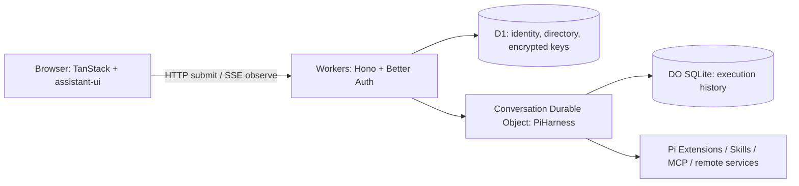

# MkHarness

**The execution foundation for extensible Agent apps.**

[English](README.md) · [简体中文](README.zh-CN.md)

Build an Agent app with a working chat UI, durable execution, and extensions on both the server and browser. MkHarness brings together **TanStack, Cloudflare, Pi, and assistant-ui** in one open-source application template.

**Start locally without signing in. Add your API key in the UI. Deploy the same app to Cloudflare.**

[MIT](LICENSE)

[Quick start](#quick-start) · [API keys](#api-keys-and-guest-access) · [Deploy](#deploy-to-cloudflare) · [Extensions](#extend-mkharness) · [Docs](#documentation)

## What you can build

MkHarness is for developers building Agent products that combine conversations, tools, interactive results, and remote services. Use it as a foundation for research assistants, data workflows, or creative Agents backed by your own service integrations.

The template provides execution and application infrastructure. Product-specific tools, media generation, billing, and subscriptions are implemented by the application developer.

## Core capabilities

| Capability                         | Included capabilities                                                                                                                                                              |
| ---------------------------------- | ---------------------------------------------------------------------------------------------------------------------------------------------------------------------------------- |
| Guest access and personal API keys | Better Auth anonymous sessions by default; optional Google sign-in; client settings for OpenAI, Anthropic, and DeepSeek keys.                                                      |
| Durable Agent execution            | PiHarness in a conversation-scoped Durable Object; queued submissions, Stop, persisted history, and reconstruction after runtime interruption. Closing a tab detaches observation. |
| Streaming chat                     | assistant-ui with AG-UI/SSE, reasoning and tool activity, model/thinking selection, conversation history, and timing decorations.                                                  |
| Extensions on both sides           | Native Pi Extensions on the server; assistant-ui Toolkits in the browser; shared resource, action, and progress contracts.                                                         |
| Interactive generated UI           | An optional OpenUI extension with forms, tables, charts, saved inputs, and bounded QuickJS calculations.                                                                           |
| Remote tools and async services    | Configured HTTPS MCP tools, static Skills, and an async-service example with polling, persisted references, and explicit handling of uncertain outcomes.                           |
| Cloudflare application stack       | TanStack Start / Router / Query, Workers, D1, and SQLite-backed Durable Objects in one repository.                                                                                 |

## Quick start

Requires **Node.js 24**, **pnpm 11.17.0**, and a supported model provider API key. Local development uses Cloudflare's local runtime and SQLite storage; no Cloudflare login or Google OAuth setup is needed.

```sh
git clone https://github.com/Yukee-798/mkharness.git
cd mkharness
pnpm install --frozen-lockfile
cp .dev.vars.example .dev.vars
pnpm setup
pnpm db:migrate
pnpm dev
```

Open **http://localhost:5173**:

1. Open the visitor menu at the bottom of the sidebar → **模型与 API Key** (Models & API Key).
2. Select your provider, enter its API key, and click **保存 Key** (Save Key).
3. Select a matching model and thinking level in the composer, then send a message.

The app currently uses Chinese UI labels; these README files are available in both languages. Saving a key does not validate it with the provider. The first model request uses it.

`pnpm setup` generates missing local authentication and encryption secrets and preserves existing values. `.dev.vars` is ignored by Git. Use the same origin (`localhost`, rather than mixing it with `127.0.0.1`) and retain local secrets across restarts.

Try the built-in example: “Use `describe_text` to count the characters in `Hello world`. Reply with text only.” No search key or MCP server is required.

## API keys and guest access

**Guest mode skips the sign-in screen, while keeping each browser's conversations and credentials isolated.** It uses an authenticated anonymous session, not a shared guest account. Clearing cookies or switching browsers loses access to that identity; cross-browser guest recovery is not included.

**Client configuration means entering a key through the UI; model execution still runs on the server.** The key is sent to your deployment and encrypted in D1 with AES-256-GCM. It is not persistently stored in the browser or included in chat history. The deployment operator holds the encryption key and can decrypt credentials: use your own deployment or one you trust.

- Personal keys take precedence over an explicitly enabled deployment key for the same provider.
- Each accepted request freezes its model, thinking level, and credential version. Queue execution, background compaction, and runtime reconstruction use that binding.
- Replacing a key affects new requests. Retired versions are retained for up to seven days for recovery; removing a provider's key revokes all its versions.
- Invalid, revoked, expired, or unavailable bound credentials fail explicitly. An accepted task never silently switches to a server key.

The default `ALLOW_SERVER_MODEL_KEY=0` requires personal keys. To offer a deployment default, explicitly set it to `1` and configure `MODEL_API_KEY`; provider usage is then billed to that key's owner.

## Deploy to Cloudflare

The deployment target is **Cloudflare Workers + D1 + Durable Objects**. Initial deployment requires resource and secret setup; an automated one-click deployment flow is not included.

### 1. Create your database and configure the app

After installing dependencies:

```sh
pnpm exec wrangler login
pnpm exec wrangler d1 create mkharness
```

Edit the **top-level** settings in `wrangler.jsonc`:

| Setting                                         | First installation                                                                                                    |
| ----------------------------------------------- | --------------------------------------------------------------------------------------------------------------------- |
| `name`                                          | `mkharness`, or your own unique Worker name.                                                                          |
| `d1_databases[0].database_name` / `database_id` | The name and ID returned by `d1 create`. The all-zero local ID cannot be used remotely.                               |
| `vars.APP_URL`                                  | Your exact public origin, such as `https://mkharness.<your-subdomain>.workers.dev`, or your configured custom domain. |
| `vars.AUTH_MODE`                                | Keep `guest` for no-sign-in access.                                                                                   |
| `vars.ALLOW_SERVER_MODEL_KEY`                   | Keep `0` for personal API keys only.                                                                                  |

Keep the `DB` and `CONVERSATIONS` bindings, `ConversationAgent` class, and migration definitions. The repository's `env.test` contains development reference resources; replace them with your own if you use that environment.

### 2. Configure secrets and deploy

Build after editing configuration so Wrangler uses the correct generated deployment configuration:

```sh
pnpm build
pnpm exec wrangler secret put BETTER_AUTH_SECRET
pnpm exec wrangler secret put CREDENTIAL_ENCRYPTION_KEY
pnpm exec wrangler d1 migrations apply DB --remote
pnpm deploy
```

Generate **two independent values** with `openssl rand -base64 32`, one for each interactive secret prompt. `CREDENTIAL_ENCRYPTION_KEY` must be the Base64 encoding of exactly 32 random bytes. If Wrangler asks to create the Worker while adding its first secret, allow creation. Retain both secrets across deployments; changing the encryption key prevents existing credentials from being decrypted.

Open the deployed URL, then configure your personal API key through the same sidebar menu. Guest mode needs **no Google credentials and no deployment model key**.

Environment selection happens at build time with the [Cloudflare Vite plugin](https://developers.cloudflare.com/workers/vite-plugin/reference/cloudflare-environments/). Rebuild after changing configuration or switching environments. For existing installations, preserve the Worker name, database ID, and Durable Object identity to retain data.

Cloudflare and model-provider usage have separate quotas and costs. Check your account's [Durable Object limits](https://developers.cloudflare.com/durable-objects/platform/limits/) before deployment; this template does not include spending caps or billing.

### Optional Google sign-in

Set `AUTH_MODE=account`, configure `GOOGLE_CLIENT_ID` and `GOOGLE_CLIENT_SECRET` as secrets, and register this callback with Google:

```text
https://YOUR_DOMAIN/api/auth/callback/google
```

Use the same origin as `APP_URL`. Guest-to-account data migration is not included.

## Extend MkHarness

| Extension point                 | Where to start                                                                                                                                  |
| ------------------------------- | ----------------------------------------------------------------------------------------------------------------------------------------------- |
| Agent tools, prompts, and hooks | Static server registration in [`src/extensions/server.ts`](src/extensions/server.ts), using native Pi Extensions.                               |
| Tool renderers and decorations  | Browser registration in [`src/extensions/browser.ts`](src/extensions/browser.ts), using assistant-ui Toolkits and tool-title/footer decorators. |
| Interactive generated UI        | [`src/extensions/openui/`](src/extensions/openui/); set `ENABLE_GENERATIVE_UI=0` to disable its tools, prompts, and UI together.                |
| Skills                          | [`src/server/skills.ts`](src/server/skills.ts); `ENABLE_EXAMPLE_SKILL=1` enables the static example.                                            |
| Remote MCP tools                | `MCP_SERVERS` configuration with server IDs, HTTPS endpoints, tool allowlists, and secret names.                                                |
| Async service integration       | [`src/server/remote-example.ts`](src/server/remote-example.ts); adapt submit/query/cancel to the provider's actual contract.                    |

The `example` and `timing` extensions demonstrate tools and presentation decorations. Extensions are reviewed code shipped with your deployment; runtime installation and an external plugin marketplace are not included. The host contracts are defined in [`src/server/contributions.ts`](src/server/contributions.ts) and [`src/browser/extensions.ts`](src/browser/extensions.ts).

## Architecture



Pi owns execution history and results. Query owns read caches; assistant-ui owns the chat presentation. Submit, observe, and Stop remain separate operations. Remote side-effect recovery requires verified provider idempotency or reconciliation; durability alone does not guarantee exactly-once execution.

## Development and scope

**MkHarness focuses on Agent infrastructure.** Attachments, R2 assets, cloud computers/sandboxes, per-user MCP OAuth, payments, and subscriptions are outside the current scope. Image/video generation requires a service extension; no generation provider is bundled. Interfaces may change while the template matures.

Two scoped dependency patches currently provide task-bound model configuration; rationale and removal criteria are documented in [`patches/README.md`](patches/README.md).

```sh
pnpm check                          # Lint, formatting, types, unit/workerd tests, build
pnpm exec playwright install chromium
pnpm test:e2e
pnpm test:hmr
```

Unit/workerd and browser tests use controlled model I/O. For your deployment, separately verify a real provider request, refresh/reconnect during execution, Stop, and recovery across redeployments. Mocked tests do not establish production acceptance.

## Documentation

- [中文快速开始](README.zh-CN.md)
- [Server extension contracts](src/server/contributions.ts)
- [Browser extension contracts](src/browser/extensions.ts)
- [Example tool renderer](src/extensions/example/browser.tsx)
- [Timing extension](src/extensions/timing/)
- [Guest access and BYOK tests](tests/e2e/guest-byok.spec.ts)
- [Task binding and recovery tests](tests/workers/task-binding.test.ts)
- [Dependency patch notes](patches/README.md)

Issues and pull requests are welcome. For bugs, include reproduction steps, dependency versions, and redacted logs; never include API keys or `.dev.vars`.

## License

[MIT](LICENSE). Upstream dependencies and borrowed components are acknowledged in [THIRD_PARTY_NOTICES.md](THIRD_PARTY_NOTICES.md).
