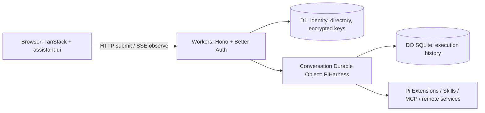

# MkHarness

**Build Agent apps with durable execution and extensible UI.**

[English](README.md) · [Chinese](README.zh-CN.md)

MkHarness is an open-source application template for building your own Agent product. It combines a streaming chat interface, persistent execution, and extensions for tools and interactive results, using **TanStack, Cloudflare, Pi, and assistant-ui**.

Start locally without signing in, add your API key in the UI, and deploy the same application to Cloudflare.

[Quick start](#quick-start) · [Features](#features) · [Extensions](#extend-mkharness) · [Deployment](#deploy-to-cloudflare) · [FAQ](#faq) · [MIT License](LICENSE)

[Try the hosted example](https://template.mkharness.com): sign in with Google and use `openrouter/free` without entering an API key. Free capacity is shared and limited, and generation quality can vary; exhaustion stops the request with a message, never switches to a paid model. Personal settings override the default.

## Quick start

You need **Node.js 24**, **pnpm 11.17.0**, and a supported model API key. Local development requires neither a Cloudflare account nor Google OAuth configuration.

```sh
git clone https://github.com/Yukee-798/mkharness.git
cd mkharness
pnpm install --frozen-lockfile
cp .dev.vars.example .dev.vars
pnpm setup
pnpm db:migrate
pnpm dev
```

Open **http://localhost:5173**:

1. Select a model in the composer.
2. Open the visitor menu at the bottom of the sidebar → **Settings → Models & API Key**. Configure **Model name**, **Base URL** and **API Key**, then click **Save configuration**.
3. Send your first message.

The interface defaults to English. Switch to Chinese in **Settings → General → Language**, and choose **Light**, **Dark**, or **System** in **Appearance**. These preferences are remembered in this browser; the default theme follows your system.

Try asking a question, requesting an interactive plan, or reading a public web page. Web search requires a separate search key; the `describe_text` sample is opt-in.

> Keys entered through the UI are sent to your deployment and encrypted on the server for background execution and recovery. Use your own deployment or one you trust. Saving a key does not test the connection; the first model request uses it.

`pnpm setup` generates missing local authentication and encryption secrets. Keep `.dev.vars` across restarts; Git ignores it. Local data lives in Cloudflare's local SQLite storage. Use `localhost` consistently rather than switching between it and `127.0.0.1`. The interface supports English and Chinese; both README languages describe the same setup.

## Features

- **A working chat app.** Streaming responses, reasoning and tool activity, model and thinking-level selection, conversation history, and reply/tool timing. Built with assistant-ui, shadcn/ui, and Tailwind CSS.
- **Image attachments.** Preview and remove PNG, JPEG, WebP, or GIF images using assistant-ui; send images with text or on their own to an image-capable model. Up to 4 images totaling 512 KiB per message, retained in Pi history for retries and recovery.
- **A durable, editable queue.** Pending messages survive refresh. Edit withdraws an unstarted message and restores its text and images to the composer; Steer joins the current work at a native Pi boundary; Remove withdraws one pending message. Already-started tasks cannot be withdrawn through queue controls. Pi remains the only queue authority.
- **Durable Agent execution.** Each conversation runs in its own Durable Object with PiHarness. Submissions queue, history persists, and execution can reconstruct after interruption. Closing the browser detaches observation; Stop is a separate action. Deletion returns `202` after durable acceptance and removal from the conversation directory; a native lifecycle alarm joins runtime shutdown and erases stored content, including after an interruption.
- **Extensions on both sides.** Add native Pi tools, prompts, and hooks on the server. Register assistant-ui Toolkits, tool-title decorations, and message footers in the browser.
- **Interactive generated UI.** The optional OpenUI extension renders forms, tables, and charts, saves inputs, and performs bounded QuickJS calculations.
- **Remote integrations.** User-added remote MCP connections with native SDK OAuth, deployment-configured MCP tools, static Skills, and an async-service example with submit/query/cancel and persisted recovery references.
- **Guest access and personal keys.** Better Auth anonymous sessions isolate each browser's data. Users configure their own model name, Base URL and API Key; Google sign-in and a deployment default key are optional.

Use this foundation for research assistants, data workflows, or creative Agents that call your services. MkHarness provides application and execution infrastructure; product-specific tools, image/video services, billing, and subscriptions are yours to add.

## Extend MkHarness

See [source architecture](ARCHITECTURE.md) for module ownership and the [engineering review](ENGINEERING_REVIEW.md) for the current cleanup and remaining architecture risks.

Extensions are trusted code that you review and ship with your application. Server capabilities and browser presentation have separate static registration points, so a tool can have a custom renderer without adding tool-specific branches to core chat logic.

| Add or customize                                           | Start here                                                                                                              |
| ---------------------------------------------------------- | ----------------------------------------------------------------------------------------------------------------------- |
| Agent tools, prompt sections, hooks                        | [`src/extensions/server.ts`](src/extensions/server.ts) — native Pi Extensions                                           |
| Tool renderers, title decorations, reply/composer footers  | [`src/extensions/browser.ts`](src/extensions/browser.ts) — assistant-ui Toolkits and browser contributions              |
| Generated UI, resources, input state, continuation actions | [`src/extensions/openui/`](src/extensions/openui/) — a complete optional extension                                      |
| Static Skills                                              | [`src/server/skills/static.ts`](src/server/skills/static.ts)                                                            |
| Deployment MCP tools                                       | [`src/server/mcp/deployment.ts`](src/server/mcp/deployment.ts) — `MCP_SERVERS` configuration                            |
| An async service                                           | [`src/extensions/async-example/`](src/extensions/async-example/) — adapt to your service's submit/query/cancel contract |

Manage all extension switches in [`extensions.config.ts`](extensions.config.ts). For a small example, set `example.enabled` to `true` there. Its [server tool, prompt section and hook](src/extensions/example/server.ts) and [browser renderer](src/extensions/example/browser.tsx) live together in `src/extensions/example/` and are disabled by default. The [timing extension](src/extensions/timing/) demonstrates decorating existing tools and replies.

Successful web reads and searches populate Sources cards from committed Pi results. The reply extension adds native assistant-ui follow-up buttons and Regenerate to the action bar. Follow-ups are localized common prompts and require no background model call. Regenerate submits a new operation referring to the original committed input, including its form context; the original answer stays in history. It uses current model settings and does not authorize replay of an unknown remote side effect.

Set `openui.enabled` to `false` to disable OpenUI's tools, prompts, resources, actions, UI and computation together; set `'skills-example'.enabled` to `true` to try the static Skill example. `timing`, `web`, `reply`, `async-example`, `example`, and the host MCP integration use the same configuration file. `openui.inspect` controls the optional developer inspector. Rebuild/redeploy after changing deployment configuration, or restart local development. The former per-extension environment switches are no longer used. Web search is registered only when `TAVILY_API_KEY` is configured; reading web pages needs no search key.

OpenUI's form catalog includes sliders (single value or range), switches, dates, selects, checkboxes, and text fields. `Progress` uses shadcn/ui to display measured or computed progress. For example, the following document updates the progress bar locally as the slider changes; editing does not call the Agent:

```text
$amount = [40]
root = Stack([
  Slider("amount", "continuous", 0, 100, 1, null, "Amount", null, $amount),
  Progress($amount[0], "Target", 100, true)
])
```

Use two slider values for a range, such as `[20, 80]`. Use `Progress(null, "Waiting for data")` when progress is unknown; it does not track background Agent tasks automatically.

See the [server contracts](src/server/extensions/contributions.ts), [browser contracts](src/browser/extensions/extensions.ts), and [.dev.vars.example](.dev.vars.example) for the available interfaces and configuration. Runtime plugin installation and marketplace compatibility are not included.

The async-service sample is assembled as the `async-example` contribution in the same server and browser registration lists. Set `ASYNC_SERVICE_URL` to install its native tools and tasks; the contribution can still display and guard previously saved outcomes when the service is unconfigured. Its directory owns the provider contract, retry/recheck authorization, native task recovery and progress cards. To omit the sample entirely, set `'async-example'.enabled` to `false`; basic chat, history, Stop and MCP remain independent.

The host offers three execution boundaries (`beforeModel`, idle `beforeSubmit`, and `taskUnavailable`), declared native document projections (`stateDocuments` + `projectState`), and a browser `composerFooter` slot. Execution stays in Pi Durable. Native task/document names are retained for existing work; already accepted legacy action receipts are decoded only inside the sample. New retry/recheck requests use `extension_action` with `extensionId: "async-example"` and a validated `{ taskId }` payload. MCP retains its own guard and an opaque view of the legacy shared document, without importing sample code.

Generic finite-JSON validation, size checks and canonical equality live in `src/shared/json.ts`, which has no compute-engine imports. QuickJS, its budgets, browser Worker, WASM bindings and build integration belong to `src/extensions/openui/`. A disabled OpenUI build excludes the extension's browser/server entries and their computation assets; core chat, MCP, requests and JSON utilities never import QuickJS. Dependencies remain listed in the template's package manifest for builds that enable OpenUI. Service endpoints, API keys and MCP connection definitions remain server bindings; they configure a connection rather than enable an extension. Disabling MCP prevents connections and tool registration, while persisted unknown-outcome protection remains in the host.

## Custom remote MCP connections

Open **Settings → Connections → Add connection**, enter a name and a public HTTPS Streamable HTTP endpoint (for example, `https://mcp.notion.com/mcp`), and connect. Automatic OAuth uses the Cloudflare Agents SDK for protected-resource/authorization-server discovery, client registration, PKCE, callback validation, token exchange and refresh. HTTPS deployments publish client metadata at `/api/mcp/client-metadata`; servers without dynamic registration or client metadata support can use the advanced pre-registered Client ID/secret fields. OAuth compatibility depends on the server; arbitrary nonstandard provider flows are not bundled. Anonymous local sessions and signed-in cloud accounts own separate connections.

Newly discovered tools default to **Ask every time**. Each tool can be disabled or allowed automatically. New chats freeze enabled tool definitions; permission restrictions and disconnects apply again immediately before dispatch. Tool or authorization changes require a new chat. Pending confirmations appear beside their tool invocation and survive refresh; Reject and Stop prevent undispatched operations. An interrupted dispatched call is marked **outcome unknown** and is never resent automatically. That connection remains blocked until externally reconciled; this version has no manual outcome-resolution action. Disconnecting erases locally stored tokens; revoke the application's authorization at the provider separately if needed.

The configuration UI reuses `@assistant-ui/react-mcp` primitives with a server-backed presentation adapter. Approval cards reuse the assistant-ui registry component. Connections, OAuth credentials and tool execution remain on the server; the browser does not install the default MCP manager, persist connection credentials or register frontend tools. Approval decisions update the existing Pi task through the extension control endpoint.

`mcp.enabled` controls all MCP integration; `mcp.custom` controls user-managed connections separately. Apply D1 migrations (`0007_mcp_connections.sql` is additive) and provision the `MCP_CONNECTIONS` SQLite Durable Object binding before enabling the feature on an existing deployment. `CREDENTIAL_ENCRYPTION_KEY` encrypts Bearer credentials, OAuth client secrets and tokens in each connection's DO. Keep that key stable; credentials never enter conversation bindings or public projections.

The module boundaries are:

- `src/server/mcp/connections/`: user ownership/catalog, encrypted connection state, native SDK adapter, HTTP routes and endpoint policy.
- `src/extensions/mcp/`: native Pi tools/tasks/documents for confirmation and interruption recovery, plus browser presentation through the existing extension slot. Confirmation decisions use the generic extension control endpoint and never start a second model run.
- `src/server/mcp/deployment.ts`: existing deployment-managed `MCP_SERVERS`; independent of user connection credentials.

The first version supports public HTTPS Streamable HTTP endpoints, bounded JSON tool schemas, and text/structured-JSON results. Unsupported schemas are visible but cannot be enabled. It does not execute local stdio commands, fetch remote schema references, or implement MCP Apps, sampling, resources or prompts as user-facing capabilities. Private/reserved destinations and HTTP redirects are rejected for both MCP and OAuth requests, with DNS preflight, timeouts and response limits. DNS preflight is defense in depth; deployments needing strict DNS-rebinding protection must also enforce a network egress boundary.

## User skills

Open **Settings → Skills → Import skill** and upload a Markdown `SKILL.md` or a ZIP containing one skill directory. Review the instructions, file list and compatibility notes before saving. A skill needs YAML frontmatter with `name` and `description` plus a nonempty Markdown body. The optional parent directory must match `name`. Reference files and templates are supported; scripts are stored/read as text and are never executed. Binary assets are retained but unavailable to the agent in this version. Skill content does not authorize tools or provide credentials.

Enabled skills are selected by default for a new chat; manage them in Settings → Skills. The server pins immutable content versions when creating the chat. Uploading a new version, disabling or removing a library entry affects future chats; older chats retain their bound versions and previously loaded instructions. Removal is a library operation, not erasure of historical versions. At most 32 library entries and 8 selected skills are accepted; uploads are limited to 1 MiB compressed, 2 MiB expanded, 128 KiB per file, and 64 files per package.

The runtime reuses `skills(sources)` from `agents/harness/pi`, with `SkillSource` adapters for pinned, owner-checked objects. The native `activate_skill` and `read_skill_resource` tools commit instructions/resources into ordinary Pi history. The directory enters the prompt first; instructions enter the model context on activation. The SDK currently reads instruction bodies during initialization, so only selected versions are installed and reference files are fetched on demand. Skill activity and versions are shown in tool records; the composer has no persistent skill or connection summary. Skills share existing MCP permissions and confirmation controls. No CLI host, second execution loop, automatic script runner or OpenUI/QuickJS coupling is added.

`skills.enabled` in `extensions.config.ts` controls the feature. Apply `0008_skills.sql` and configure a **private** R2 bucket as `SKILL_FILES` before enabling it on an existing deployment. D1 stores ownership, revisions, version metadata and conversation bindings; R2 stores immutable files, checked against their content hashes on reads. Provision the bucket name configured for the intended Wrangler environment, for example `pnpm exec wrangler r2 bucket create mkharness-template-skills` for the sample production configuration. This is an additional resource, separate from the D1 migration. The legacy `skills-example` remains optional; if enabled together, both source kinds share one native Skills extension.

- `src/server/skills/`: bounded import validation, D1/R2 catalog, versioned sources and authenticated management routes. Frontmatter uses the YAML library also used by the SDK; importing the SDK's broad parser entry would require its optional script-runtime dependencies.
- `src/extensions/skills/`: native Pi integration, result projection and browser selection/presentation. User packages remain data, not executable extension modules.

## Deploy to Cloudflare

The application runs on **Workers + D1 + SQLite-backed Durable Objects**. First deployment requires the following resource and secret setup.

### 1. Create resources

After installing dependencies:

```sh
pnpm exec wrangler login
pnpm exec wrangler d1 create mkharness
```

Edit the **top-level configuration** in [`wrangler.jsonc`](wrangler.jsonc):

| Setting                                         | Value                                                                           |
| ----------------------------------------------- | ------------------------------------------------------------------------------- |
| `name`                                          | `mkharness`, or your own Worker name                                            |
| `d1_databases[0].database_name` / `database_id` | The name and ID returned by `d1 create`; replace the all-zero local placeholder |
| `vars.APP_URL`                                  | Your exact public origin, e.g. `https://mkharness.<your-subdomain>.workers.dev` |
| `vars.AUTH_MODE`                                | `guest` for access without a sign-in screen                                     |
| `vars.ALLOW_SERVER_MODEL_KEY`                   | `0` for personal API keys only                                                  |

Keep the `DB` and `CONVERSATIONS` bindings, `ConversationAgent` class, and migration definitions. The repository's `env.test` contains development reference resources; substitute your own if using that environment.

### 2. Set secrets and deploy

Build after editing configuration so Wrangler uses the intended generated deployment configuration:

```sh
pnpm build
pnpm exec wrangler secret put BETTER_AUTH_SECRET
pnpm exec wrangler secret put CREDENTIAL_ENCRYPTION_KEY
pnpm exec wrangler d1 migrations apply DB --remote
pnpm deploy
```

Run `openssl rand -base64 32` twice to generate **two independent secrets** and enter them at the corresponding prompts. The encryption key must encode exactly 32 random bytes. If Wrangler asks to create the Worker when setting its first secret, allow creation.

Keep these secrets across deployments. Changing the encryption key prevents existing credentials from being decrypted. For existing installations, also preserve the Worker name, database ID, and Durable Object identity. [Environment selection happens at build time](https://developers.cloudflare.com/workers/vite-plugin/reference/cloudflare-environments/); rebuild after changing configuration or environments.

### 3. Open your app

Visit the deployed URL and configure your personal API key through the sidebar menu. Guest mode needs no Google credentials and no deployment model key.

For Google sign-in, set `AUTH_MODE=account`, add `GOOGLE_CLIENT_ID` and `GOOGLE_CLIENT_SECRET` as secrets, and register `https://YOUR_DOMAIN/api/auth/callback/google` with the same origin as `APP_URL`.

Cloudflare and model usage are billed separately. Check your account's [Durable Object limits](https://developers.cloudflare.com/durable-objects/platform/limits/). Resource provisioning is manual; the template does not provide an automated one-click deployment or spending caps.

## Architecture



**Pi owns execution history and results; Query owns read caches; assistant-ui owns chat presentation.** Submit, observe, and Stop are separate operations. Remote side effects require provider idempotency or reconciliation; durable execution alone does not guarantee exactly-once delivery.

To provide the same free default on your own deployment, set `MODEL_PROVIDER=openrouter`, `MODEL_ID=openrouter/free`, `MODEL_THINKING_LEVEL=off`, and `ALLOW_SERVER_MODEL_KEY=1`, then store an OpenRouter key as the `MODEL_API_KEY` Worker secret. The deployment key only authorizes models explicitly configured through `MODEL_ID` / `MODEL_IDS`; personal keys can select other registered models. No paid fallback is configured. Each Agent turn or compaction consumes another provider request, so a chat can use several free requests. [OpenRouter free routing](https://openrouter.ai/docs/guides/routing/routers/free-router).

## FAQ

<details>
<summary><strong>How are guest identities and API keys stored?</strong></summary>

Each browser gets an authenticated anonymous Better Auth session. Clearing cookies or switching browsers loses access to that guest identity; cross-browser recovery and guest-to-account migration are not included.

Keys are encrypted in D1 with AES-256-GCM, excluded from chat history. Browser storage is opt-in: “Remember API key in this browser” keeps a plaintext copy in localStorage for this identity, cleared on sign-out; it is never automatically re-uploaded. The deployment operator holds the encryption secret and can decrypt them. The most recently saved personal model is the default for new submissions; its key takes precedence over a deployment key for the same provider. The default `ALLOW_SERVER_MODEL_KEY=0` requires users to supply a key; setting it to `1` with `MODEL_API_KEY` enables an operator-funded default.

The local template’s default model list contains only DeepSeek-V4.1-Flash (`deepseek-flash`). A saved model name must be registered in Pi's native catalog; configure `MODEL_IDS` to expose additional models.

Known provider endpoints select their native Pi provider. Custom Base URLs must be public HTTPS endpoints supporting the selected provider's API protocol; changing a custom gateway address does not infer a different protocol. Redirects and private-network destinations are rejected.

</details>

<details>
<summary><strong>What happens when model settings change during execution?</strong></summary>

Each newly accepted message updates its conversation configuration. Before preparing context, Pi snapshots the model, thinking level, and immutable credential reference for each model call. Queued messages and later tool rounds use the current conversation configuration; prepared request checkpoints retain their original version across recovery.

Saving a key or Base URL alone does not update a running conversation. The next accepted message applies that version to calls not yet prepared. Generation retries that re-enter prepare select current configuration. Compaction selects its own configuration, then retains that summary checkpoint through recovery and retries.

Retired credential versions are retained for up to seven days. Removing a provider key revokes all its versions. Invalid, revoked, expired, or unavailable checkpoint credentials fail explicitly; they never silently fall back to a newer or deployment key. See the [step configuration tests](tests/workers/task-binding.test.ts).

</details>

<details>
<summary><strong>What is outside the template's scope?</strong></summary>

Attachments, R2 assets, cloud computers/sandboxes, payments, and subscriptions are not bundled. Image/video generation requires a service extension. Interfaces may change as the template develops.

</details>

<details>
<summary><strong>Does MkHarness patch its dependencies?</strong></summary>

Pi Durable uses native step configuration without a patch. Two independent fixes remain in `agents`: the Skills result bridge and failed-Session cache cleanup. Their rationale and removal criteria are documented in [patch notes](patches/README.md).

</details>

## Development & contributing

```sh
pnpm check                          # Lint, formatting, types, unit/workerd tests, build
pnpm exec playwright install chromium
pnpm test:e2e
pnpm test:hmr
```

E2E uses the Cloudflare Vite production preview from isolated `.wrangler/e2e-build` output. Component fixtures are bundled separately and excluded from normal deployment artifacts; HMR tests exercise the development server separately.

Tests use controlled model I/O. Verify a real provider request, refresh/reconnect, Stop, and recovery across redeployments in your own environment; these tests do not establish real-cloud acceptance.

[Open an issue](https://github.com/Yukee-798/mkharness/issues) or submit a pull request. Include reproduction steps, dependency versions, and redacted logs. Never include API keys or `.dev.vars`.

## License

[MIT](LICENSE). See [THIRD_PARTY_NOTICES.md](THIRD_PARTY_NOTICES.md) for upstream dependencies and borrowed components.
