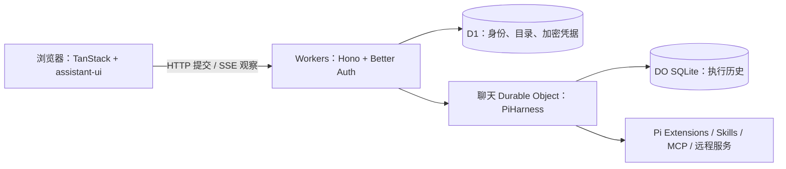

# MkHarness

**面向可扩展 Agent 应用的执行基础模板。**

[English](README.md) · [简体中文](README.zh-CN.md)

在一个开源应用仓库中，提供可用的聊天界面、持久化 Agent 执行，以及前后端扩展机制。MkHarness 基于 **TanStack、Cloudflare、Pi 和 assistant-ui**，帮助开发者从可运行的基础开始搭建自己的 Agent 产品。

**本地启动，无需登录；在界面填写自己的 API Key；同一套应用可部署到 Cloudflare。**

v0.1.0 · [MIT](LICENSE)

[快速开始](#快速开始) · [API Key](#免登录与-api-key) · [部署](#部署到-cloudflare) · [扩展](#扩展-mkharness) · [文档](#文档)

## 适合搭建什么

适合需要结合对话、工具、交互结果与远程服务的 Agent 产品，例如调研助手、数据处理工作流，或接入自有服务的创作 Agent。

模板提供执行和应用基础设施。具体业务工具、图片与视频生成、计费和订阅，由开发者按产品需要实现。

## 核心能力

| 能力                 | v0.1.0 已包含                                                                                                     |
| -------------------- | ----------------------------------------------------------------------------------------------------------------- |
| 免登录与个人 API Key | 默认 Better Auth 匿名会话；可选 Google 登录；客户端配置 OpenAI、Anthropic 和 DeepSeek Key。                       |
| 持久化 Agent 执行    | 每个聊天由独立 Durable Object 承载 PiHarness；支持排队、Stop、完整历史和 runtime 中断后重建。关闭页面只断开观察。 |
| 流式聊天             | assistant-ui + AG-UI/SSE；思考过程、工具活动、模型与思考强度选择、聊天记录及耗时装饰。                            |
| 前后端扩展           | 服务端使用 Pi 原生 Extension，浏览器使用 assistant-ui Toolkit，共用资源、动作与进度契约。                         |
| 交互式生成 UI        | 可选 OpenUI 扩展；支持表单、表格、图表、输入保存和有资源限制的 QuickJS 计算。                                     |
| 远程工具与异步服务   | 可配置 HTTPS MCP、静态 Skills，以及包含轮询、引用持久化和不确定结果处理的异步服务示例。                           |
| Cloudflare 应用栈    | TanStack Start / Router / Query、Workers、D1 和 SQLite-backed Durable Objects，位于同一仓库。                     |

## 快速开始

准备 **Node.js 24**、**pnpm 11.17.0** 和一个受支持供应商的模型 API Key。本地使用 Cloudflare 本地运行时与 SQLite 存储，**不需要 Cloudflare 登录，也不需要 Google OAuth 配置**。

```sh
git clone https://github.com/Yukee-798/mkharness.git
cd mkharness
pnpm install --frozen-lockfile
cp .dev.vars.example .dev.vars
pnpm setup
pnpm db:migrate
pnpm dev
```

打开 **http://localhost:5173**：

1. 点击侧栏底部的访客菜单 → **模型与 API Key**。
2. 选择供应商，填写对应 Key，点击 **保存 Key**。
3. 在输入框选择对应供应商的模型与思考强度，发送消息。

当前应用界面使用中文，README 提供中英文版本。保存 Key 仅代表保存成功，首次模型请求才会使用它验证实际调用。

`pnpm setup` 生成缺失的本地认证与加密密钥，保留已有值。`.dev.vars` 已被 Git 忽略。请统一使用 `localhost`，不要混用 `127.0.0.1`，并在重启后保留本地密钥。

可以先试：“请使用 `describe_text` 工具，统计‘你好世界’的字符数，只用文字回答。”此示例不需要搜索 Key 或 MCP 服务。

## 免登录与 API Key

**免登录省去了登录页面，但每个浏览器仍有独立身份。** 默认使用经过认证的匿名会话，聊天和凭据按用户隔离。清除 Cookie 或更换浏览器后无法找回原访客身份；本期不支持访客跨浏览器恢复。

**客户端配置指在界面输入 Key，模型仍由服务端调用。** Key 会发送给当前部署，并在 D1 中使用 AES-256-GCM 加密保存；浏览器不持久保存明文，也不会写入聊天历史。部署者持有主密钥，能够解密凭据，因此请在自己的部署或可信部署填写。

- 同一供应商的个人 Key 优先于显式启用的部署默认 Key。
- 每次请求接受时，冻结模型、思考强度与凭据版本；排队、后台压缩和 runtime 重建沿用该配置。
- 替换 Key 只影响新请求。退休版本最多保留七天供恢复；移除该供应商的 Key 会撤销全部版本。
- 已绑定凭据无效、撤销、过期或不可读取时，明确报错，不静默切换到服务端 Key。

默认 `ALLOW_SERVER_MODEL_KEY=0`，要求用户自行配置 Key。若需要提供部署默认 Key，显式设为 `1` 并配置 `MODEL_API_KEY`；供应商费用由该 Key 的持有者承担。

## 部署到 Cloudflare

部署目标为 **Cloudflare Workers + D1 + Durable Objects**。首次部署需要创建资源和配置 Secrets；v0.1.0 暂未提供自动化一键部署流程。

### 1. 创建数据库并配置应用

安装依赖后执行：

```sh
pnpm exec wrangler login
pnpm exec wrangler d1 create mkharness
```

修改 `wrangler.jsonc` 的**顶层配置**：

| 配置                                            | 首次安装填写                                                                             |
| ----------------------------------------------- | ---------------------------------------------------------------------------------------- |
| `name`                                          | `mkharness`，或自己的唯一 Worker 名称。                                                  |
| `d1_databases[0].database_name` / `database_id` | `d1 create` 返回的名称和 ID；全零本地占位 ID 不能用于远端。                              |
| `vars.APP_URL`                                  | 实际公开 origin，例如 `https://mkharness.<你的子域>.workers.dev`，或已配置的自定义域名。 |
| `vars.AUTH_MODE`                                | 保持 `guest`，无需登录即可使用。                                                         |
| `vars.ALLOW_SERVER_MODEL_KEY`                   | 保持 `0`，只使用个人 API Key。                                                           |

保留 `DB`、`CONVERSATIONS` binding、`ConversationAgent` 类名和迁移定义。仓库的 `env.test` 是开发参考资源；使用测试环境时必须替换为自己的资源。

### 2. 配置 Secrets 并部署

编辑配置后先构建，让 Wrangler 使用正确的生成部署配置：

```sh
pnpm build
pnpm exec wrangler secret put BETTER_AUTH_SECRET
pnpm exec wrangler secret put CREDENTIAL_ENCRYPTION_KEY
pnpm exec wrangler d1 migrations apply DB --remote
pnpm deploy
```

分别用 `openssl rand -base64 32` 生成**两个独立值**，在对应的 Secret 交互提示中输入。`CREDENTIAL_ENCRYPTION_KEY` 必须是恰好 32 字节随机值的标准 Base64。设置首个 Secret 时若 Wrangler 提示创建 Worker，可同意创建。两项密钥需跨部署保留；更换加密密钥会使已有凭据无法解密。

打开部署后的网址，通过相同的侧栏菜单配置个人 API Key。访客模式**不需要 Google 凭据，也不需要部署默认模型 Key**。

[Cloudflare Vite 插件](https://developers.cloudflare.com/workers/vite-plugin/reference/cloudflare-environments/)在构建时选择环境。修改配置或切换环境后重新构建。已有安装升级时，保留 Worker 名称、数据库 ID 和 Durable Object 身份，以保留数据。

Cloudflare 与模型供应商分别有配额及费用。部署前核对账号的 [Durable Object 限制](https://developers.cloudflare.com/durable-objects/platform/limits/)；模板不包含费用硬上限或计费系统。

### 可选：Google 登录

设为 `AUTH_MODE=account`，通过 Secrets 配置 `GOOGLE_CLIENT_ID` 和 `GOOGLE_CLIENT_SECRET`，在 Google 注册回调：

```text
https://YOUR_DOMAIN/api/auth/callback/google
```

回调来源与 `APP_URL` 保持一致。本期不包含访客到账号的数据迁移。

## 扩展 MkHarness

| 扩展内容                   | 接入位置                                                                                                            |
| -------------------------- | ------------------------------------------------------------------------------------------------------------------- |
| Agent 工具、提示词与 hooks | 在 [`src/extensions/server.ts`](src/extensions/server.ts) 静态装配 Pi 原生 Extension。                              |
| 工具渲染与展示装饰         | 在 [`src/extensions/browser.ts`](src/extensions/browser.ts) 登记 assistant-ui Toolkit，以及工具标题 / Footer 装饰。 |
| 交互式生成 UI              | [`src/extensions/openui/`](src/extensions/openui/)；`ENABLE_GENERATIVE_UI=0` 可同时关闭其工具、提示词与 UI。        |
| Skills                     | [`src/server/skills.ts`](src/server/skills.ts)；`ENABLE_EXAMPLE_SKILL=1` 启用静态示例。                             |
| 远程 MCP 工具              | `MCP_SERVERS` 配置 server ID、HTTPS endpoint、工具白名单与凭据变量名。                                              |
| 异步服务                   | [`src/server/remote-example.ts`](src/server/remote-example.ts)；按供应商实际契约改造 submit/query/cancel。          |

`example` 和 `timing` 展示工具与 UI 装饰的接入方式。扩展是经审核并随部署发布的代码，本期不支持运行时安装或外部插件市场。宿主契约定义见 [`src/server/contributions.ts`](src/server/contributions.ts) 和 [`src/browser/extensions.ts`](src/browser/extensions.ts)。

## 架构



Pi 负责执行历史与结果；Query 负责读取缓存；assistant-ui 负责聊天展示。提交、观察和 Stop 独立。远程副作用恢复需要验证供应商的幂等或调和契约，持久化本身不保证操作只执行一次。

## 版本状态与开发

**v0.1.0 是早期的开源基础版本。** 附件、R2 素材、云端电脑/沙箱、每用户 MCP OAuth、支付和订阅不在本期范围。图片/视频生成需要接入对应服务扩展，模板未内置生成供应商。接口可能随迭代调整。

当前保留两个用于逐任务模型配置的依赖补丁，原因及移除条件见 [`patches/README.md`](patches/README.md)。

```sh
pnpm check                          # lint、格式、类型、unit/workerd 测试及构建
pnpm exec playwright install chromium
pnpm test:e2e
pnpm test:hmr
```

unit/workerd 与浏览器测试使用受控模型 I/O。部署后需独立验收真实供应商请求、运行中刷新/重连、Stop 和跨部署恢复；模拟测试不代表生产验收通过。

## 文档

- [English README](README.md)
- [服务端扩展契约](src/server/contributions.ts)
- [浏览器扩展契约](src/browser/extensions.ts)
- [示例工具 renderer](src/extensions/example/browser.tsx)
- [耗时扩展](src/extensions/timing/)
- [免登录与 BYOK 测试](tests/e2e/guest-byok.spec.ts)
- [任务绑定与恢复测试](tests/workers/task-binding.test.ts)
- [依赖补丁说明](patches/README.md)

欢迎提交 Issue 和 Pull Request。报告问题时请提供复现步骤、依赖版本和脱敏日志，不要附带 API Key 或 `.dev.vars`。

## 许可证

[MIT](LICENSE)。上游依赖与借用组件归属见 [THIRD_PARTY_NOTICES.md](THIRD_PARTY_NOTICES.md)。
