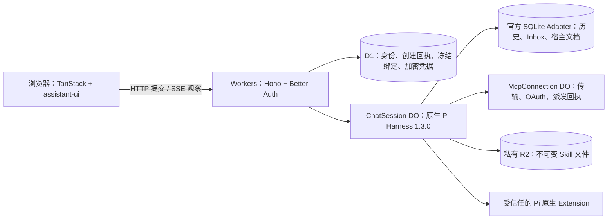

# MkHarness

**搭建拥有持久化执行与可扩展 UI 的 Agent 应用。**

[English](README.md) · [简体中文](README.zh-CN.md)

MkHarness 是一个开源 Agent 应用模板，提供流式聊天、持久化执行，以及工具与交互结果的扩展能力。基于 **TanStack、Cloudflare、Pi 和 assistant-ui**，帮助你从可运行的工程开始搭建自己的 Agent 产品。

本地启动无需登录，在界面配置自己的 API Key，同一套应用可部署到 Cloudflare。

[快速开始](#快速开始) · [核心能力](#核心能力) · [扩展](#扩展-mkharness) · [部署](#部署到-cloudflare) · [常见问题](#常见问题) · [MIT 许可证](LICENSE)

原生 Pi 替换使用独立的新空环境。公开域名切换与真实供应商验收仍待完成，之前的在线示例不代表当前运行时已经通过验收。

## 快速开始

准备 **Node.js 24**、**pnpm 11.17.0** 和一个受支持的模型 API Key。本地开发不需要 Cloudflare 账号，也不需要配置 Google OAuth。

```sh
git clone https://github.com/Yukee-798/mkharness.git
cd mkharness
pnpm install --frozen-lockfile
cp .dev.vars.example .dev.vars
pnpm setup
pnpm dev
```

打开 **http://localhost:5173**：

1. 在输入框选择模型。
2. 点击侧栏底部的访客菜单 → **Settings → Models & API Key**，填写 **模型名**、**Base URL** 和 **API Key**，点击 **Save configuration**。
3. 发送第一条消息。

应用界面默认英文。可在 **Settings → General → Language** 切换中文，在 **Appearance** 选择浅色、深色或跟随系统。偏好保存在当前浏览器，默认主题跟随系统。

可以先尝试提问、生成交互式计划或读取公开网页。网页搜索需要单独配置搜索 Key；`describe_text` 示例默认关闭。

> 在界面填写的 Key 会发送给当前部署，并在服务端加密保存，用于后台执行与恢复。请在自己的部署或可信部署填写。保存 Key 不会测试连接，首次模型请求才会实际使用它。

`pnpm setup` 生成缺失的本地认证与加密密钥，并把 `migrations/0001_initial.sql` 应用于新的本地 D1。重启时保留 `.dev.vars`，该文件已被 Git 忽略。数据保存在隔离的 `.wrangler/native-state`。Setup 仅接受空库或当前基线，拒绝旧 schema，不导入账号、聊天、凭据、MCP 连接或 Skills。`node scripts/setup.mjs --check` 只检查本地状态，不修改密钥或应用迁移。统一使用 `localhost`，不要与 `127.0.0.1` 混用。

## 核心能力

- **图片附件。** 复用 assistant-ui 预览与移除 PNG、JPEG、WebP、GIF；支持图片加文字或纯图片提交，需选择支持图片的模型。每条消息最多 4 张、合计 512 KiB，随 Pi 历史保留，用于重试和恢复。
- **可编辑的持久化队列。** 待执行消息在刷新后恢复。重新编辑会撤回尚未开始的消息并回填文字与图片；引导在 Pi 原生边界加入当前任务；移除只撤回选中的排队消息。已开始的任务不能通过队列操作撤回，Pi 始终是唯一队列权威。
- **可用的聊天应用。** 流式回复、思考过程、工具活动、模型与思考强度选择、聊天历史，以及回复和工具耗时。使用 assistant-ui、shadcn/ui 与 Tailwind CSS。
- **持久化 Agent 执行。** 每个聊天由 `ChatSession` Durable Object 承载一个原生 Pi Durable 1.3.0 Harness，使用官方 SQLite Adapter。Pi 负责提交、Inbox、历史和任务恢复。关闭浏览器只断开观察，Stop 是独立操作。删除持久化 tombstone 和清理 alarm 后返回 `202`、隐藏聊天，等待运行时关闭再擦除内容；D1 保留最小创建/删除回执，阻止迟到调用复活聊天。
- **前后端扩展。** 服务端接入 Pi 原生工具、提示词与 hooks；浏览器注册 assistant-ui Toolkit、工具标题装饰和回复 Footer。
- **交互式生成 UI。** 可选 OpenUI 扩展支持表单、表格、图表、输入保存，以及有资源限制的 QuickJS 计算。
- **远程集成。** 用户可添加远程 MCP 并通过原生 SDK 完成 OAuth，也支持部署级 HTTPS MCP 工具、静态 Skills，以及包含 submit/query/cancel 和恢复引用保存的异步服务示例。
- **免登录与个人 Key。** Better Auth 匿名会话隔离各浏览器的数据；用户自行配置模型名、Base URL 与 API Key，也可启用 Google 登录和部署默认 Key。

你可以在此基础上搭建调研助手、数据工作流，或调用自有服务的创作 Agent。MkHarness 提供应用与执行基础设施；业务工具、生图/视频服务、计费与订阅由你按需接入。

## 扩展 MkHarness

当前目录职责与运行时契约见[源码架构](ARCHITECTURE.md)。[历史工程评审](ENGINEERING_REVIEW.md)记录替换前的快照，不作为当前架构或验收指南。

扩展是经你审核、随应用部署发布的受信任代码。服务端能力与浏览器展示各有独立的静态装配入口，工具可以接入专属 renderer，无需在核心聊天逻辑增加工具名分支。

| 扩展内容                             | 从这里开始                                                                                                |
| ------------------------------------ | --------------------------------------------------------------------------------------------------------- |
| Agent 工具、提示词片段、hooks        | [`src/extensions/server.ts`](src/extensions/server.ts) — Pi 原生 Extension                                |
| 工具 renderer、标题装饰、回复 Footer | [`src/extensions/browser.ts`](src/extensions/browser.ts) — assistant-ui Toolkit 与浏览器贡献              |
| 生成 UI、资源、输入状态、继续动作    | [`src/extensions/openui/`](src/extensions/openui/) — 完整的可选扩展                                       |
| 原生 Skills 数据桥接                 | [`src/server/skills/native.ts`](src/server/skills/native.ts)                                              |
| 部署级 MCP 工具                      | [`src/server/mcp/deployment.ts`](src/server/mcp/deployment.ts) — `MCP_SERVERS` 配置                       |
| 异步服务                             | [`src/extensions/async-example/`](src/extensions/async-example/) — 按实际服务契约接入 submit/query/cancel |

最小工具示例只需在 [`extensions.config.ts`](extensions.config.ts) 将 `example.enabled` 设为 `true`。其[服务端工具、提示词与 hook](src/extensions/example/server.ts)及[浏览器 renderer](src/extensions/example/browser.tsx) 统一放在 `src/extensions/example/`，默认不启用。[耗时扩展](src/extensions/timing/)演示如何装饰已有工具和回复。

成功的网页读取和搜索从 Pi 已提交结果生成 Sources 来源卡片。回复扩展使用 assistant-ui 原生后续提问按钮，并在操作栏增加重新生成。后续提问是随语言切换的通用提示，不额外调用模型。重新生成以新操作引用原始提交内容（含表单上下文），保留原回答，使用当前模型设置；它不会授权自动重放结果未知的远端副作用。

所有扩展启停统一在 [`extensions.config.ts`](extensions.config.ts) 配置：`openui.enabled: false` 同时关闭 OpenUI 的工具、提示词、资源、动作、界面和计算；`skills-example.enabled: true` 启用静态 Skill 示例。timing、web、reply、async-example、example 和宿主 MCP 接入使用同一个文件，`openui.inspect` 控制开发检查器。修改后重新构建部署，或重启本地开发服务；原有扩展专用环境变量不再使用。网页搜索仅在配置 `TAVILY_API_KEY` 时注册，读取网页不需要搜索 Key。

OpenUI 表单目录已包含单值或范围滑块、开关、日期、下拉选择、复选框与文本输入。`Progress` 使用 shadcn/ui 展示实际测量或计算得到的进度。例如，以下内容在滑块改变后本地更新进度条，编辑时不调用 Agent：

```text
$amount = [40]
root = Stack([
  Slider("amount", "continuous", 0, 100, 1, null, "数值", null, $amount),
  Progress($amount[0], "目标", 100, true)
])
```

范围滑块使用两个值，例如 `[20, 80]`。进度未知时使用 `Progress(null, "等待数据")`；它不会自动追踪后台 Agent 任务。

具体接口与配置见[服务端契约](src/server/extensions/contributions.ts)、[浏览器契约](src/browser/extensions/extensions.ts)及 [.dev.vars.example](.dev.vars.example)。不包含运行时插件安装器或外部插件市场兼容层。

异步服务示例以 `async-example` contribution 接入服务端与浏览器注册表。配置 `ASYNC_SERVICE_URL` 后安装其原生工具和任务；未配置服务时，扩展仍可展示和保护已有任务的未知结果。服务协议、重试与复查授权、原生任务恢复和进度卡片都位于该扩展目录。要完全停用示例，在统一配置中将 `async-example.enabled` 设为 `false`，基础聊天、历史、Stop 和 MCP 保持独立。

宿主提供两个执行接入点：模型请求前的 `beforeModel`，以及队列空闲且新请求入站时的 `beforeSubmit`。`stateDocuments` 声明原生文档，`projectConversation` 投影会话状态，`projectHistory` 提供逐消息 annotations，`composerFooter` 展示会话控件。重试/复查使用 `extension_action`、`extensionId: "async-example"` 与经过校验的 `{ taskId }`。示例独立管理自己的供应商意图和调和策略；MCP 通过连接 DO 保存独立回执，不读取示例文档。

通用 JSON 校验、大小限制和规范化比较位于 `src/shared/json.ts`，不导入计算引擎。QuickJS、计算预算、浏览器 Worker、WASM 接入和构建集成都属于 `src/extensions/openui/`。构建时关闭 OpenUI 会排除该扩展的浏览器与服务端入口及计算资源；核心聊天、MCP、请求处理和 JSON 工具不导入 QuickJS。模板的依赖清单仍保留相关包，供启用 OpenUI 时构建使用。服务地址、API Key 和 MCP 连接定义仍放在服务端绑定中，它们负责连接参数，不负责扩展启停。关闭 MCP 会停止建立连接及注册工具，宿主仍保留已有未知结果的保护记录。

## 自定义远程 MCP 连接

在 **设置 → 连接 → 添加连接** 中填写名称和公开 HTTPS Streamable HTTP 地址（例如 `https://mcp.notion.com/mcp`）。自动 OAuth 复用 Cloudflare Agents SDK 的服务发现、客户端注册、PKCE、回调校验、令牌交换与刷新。HTTPS 部署通过 `/api/mcp/client-metadata` 发布客户端元数据；不支持动态注册或客户端元数据的服务，可在高级设置填写预注册 Client ID 和 secret。兼容性取决于服务端，未内置各家非标准 OAuth 流程。本地匿名身份与云端登录账号均拥有各自的连接。

新发现的工具默认 **每次询问**，也可逐个禁用或自动允许。新聊天固定当时启用的工具定义，真正派发前再次检查当前权限和连接状态；工具定义或授权身份变化后需创建新聊天。确认卡片跟随对应的工具调用展示，刷新后可恢复；拒绝和 Stop 会阻止尚未派发的请求。已派发但未确认结果的操作标记为 **结果未知**，不会自动重发，该连接在外部核对前保持阻塞；本版尚未提供手动核对结果的操作。断开连接会删除本地令牌；如需撤销服务商授权，还需在服务商处单独操作。

配置界面复用 `@assistant-ui/react-mcp` 原语，通过展示适配器操作现有后端；确认卡片复用 assistant-ui 官方 registry 组件。连接、OAuth 凭据和工具执行仍由服务端管理，浏览器不启用默认 MCP Manager、不持久化连接凭据，也不注册前端工具。确认决定通过扩展 control 接口更新已有 Pi 任务。

`mcp.enabled` 管理所有 MCP 接入，`mcp.custom` 单独管理用户自定义连接。新 D1 基线已包含连接目录，Wrangler `exports` 声明 `McpConnection` 为 SQLite DO，由 `MCP_CONNECTIONS` 绑定。新环境需重新连接，不导入 OAuth grant 或令牌。Bearer、OAuth 客户端 secret 和令牌使用 `CREDENTIAL_ENCRYPTION_KEY` 在连接 DO 内加密保存，密钥应保持稳定；凭据不进入聊天绑定或公开状态。

模块分工：

- `src/server/mcp/connections/`：用户与部署连接 scope、加密状态、SDK 传输、派发回执、HTTP 路由和端点策略。
- `src/extensions/mcp/`：通过 Pi 原生工具、任务和文档实现确认与中断恢复，通过现有扩展插槽呈现界面。确认决定走通用扩展 control 接口，不会启动第二次模型请求。
- `src/server/mcp/deployment.ts`：部署级 `MCP_SERVERS`、冻结工具定义和调用独立连接 DO 的原生工具/任务。

首版支持公开 HTTPS Streamable HTTP、受限 JSON 工具 schema、文本和结构化 JSON 结果。不支持的 schema 会展示但无法启用。不会执行本地 stdio 命令或抓取远程 schema 引用，暂未将 MCP Apps、sampling、resources 和 prompts 作为产品能力开放。MCP 和 OAuth 请求均限制私网/保留地址、重定向、超时和响应大小，并做 DNS 预检；DNS 预检属于纵深防御，需要严格抵御 DNS 重绑定的部署还应配置网络出口隔离。

## 用户技能

在 **设置 → 技能 → 导入技能** 上传 Markdown `SKILL.md`，或仅包含一个技能目录的 ZIP，预览说明、文件清单与兼容性提示后保存。Skill 需要 YAML frontmatter 中的 `name`、`description` 与非空 Markdown 正文；如包裹在目录中，目录名应与 `name` 一致。支持参考文档和文本模板，脚本仅保存/读取为文本，不会执行；二进制资源会保留，但本版 Agent 暂不支持读取。Skill 不授予工具权限，也不提供凭据。

新聊天默认选择账号已启用技能，可在设置 → 技能中管理启停。服务端创建聊天时绑定不可变内容版本；更新、停用或从库中删除仅影响新聊天，已有聊天保留绑定版本与已加载说明。删除是移出技能库，不会擦除历史版本。最多保存 32 个在库技能、每个聊天最多选择 8 个；上传最多 1 MiB、解压后最多 2 MiB、单文件最多 128 KiB、每包最多 64 个文件。

`src/server/skills/native.ts` 中的 `nativeSkills` 直接注册 Pi 原生 `activate_skill` 和 `read_skill_resource`，使用 1.3.0 的 `output` 结果契约。冻结目录元数据先进入提示词，激活时延迟加载正文，读取资源时按需获取私有 R2 对象；工具结果进入普通 Pi 历史。来源校验账号归属、不可变版本、路径、大小和哈希。技能在设置中管理，不授予工具权限，也不执行脚本。

`extensions.config.ts` 中的 `skills.enabled` 控制启停。新 D1 基线包含技能元数据，`SKILL_FILES` 绑定私有 R2 桶。D1 保存归属、修订、版本和聊天绑定，R2 保存不可变文件。请创建目标环境的桶，例如生产环境使用 `pnpm exec wrangler r2 bucket create mkharness-native-skills`，保持公开访问关闭。这是独立于 D1 的资源；新环境通过正常入口重新导入/发布 Skills。`skills-example` 仍可单独启用，两类来源共享原生 Skills 扩展。

- `src/server/skills/`：受限导入校验、D1/R2 目录、固定版本来源和鉴权管理路由。Frontmatter 使用与 SDK 相同的 YAML 库，避免其公共解析入口连带加载可选脚本运行器依赖。
- `src/extensions/skills/`：原生 Pi 接入、结果投影、浏览器选择与展示。用户上传的包是数据，不会成为可执行扩展模块。

## 部署到 Cloudflare

应用使用 **Workers + D1 + SQLite-backed Durable Objects + 私有 R2**。原生运行时需要新的 Worker、D1、`ChatSession` / `McpConnection` namespace 和 Skills 桶。账号、聊天、模型 Key、MCP grant 和 Skills 全部重新配置，当前基线不能用于升级旧库。

### 1. 创建资源

```sh
pnpm exec wrangler login
pnpm exec wrangler d1 create mkharness-native
pnpm exec wrangler r2 bucket create mkharness-native-skills
```

构建前修改 [`wrangler.jsonc`](wrangler.jsonc) 的 **`env.production`**：

| 配置                                            | 填写内容                                             |
| ----------------------------------------------- | ---------------------------------------------------- |
| `name`                                          | `mkharness-native` 或其他尚未使用的 Worker 名        |
| `d1_databases[0].database_name` / `database_id` | 刚创建的新 D1 名称和 ID                              |
| `r2_buckets[0].bucket_name`                     | 新的私有桶名称                                       |
| `vars.APP_URL`                                  | 自己部署的精确 origin，替换 `template.mkharness.com` |
| `vars.AUTH_MODE`                                | Google 登录使用 `account`，访客使用 `guest`          |
| `vars.ALLOW_SERVER_MODEL_KEY`                   | `0`，仅使用个人 Key                                  |

保留 `DB`、`SKILL_FILES`、`CONVERSATIONS` → `ChatSession`、`MCP_CONNECTIONS` → `McpConnection`。使用 declarative `exports` 声明 SQLite DO，不添加旧 migration tag 或转移旧 namespace。自行安装时，将 production 和 test 的数据库 ID 替换为自己刚创建的资源 ID。本地配置省略 D1 ID；Wrangler 可在部署时自动创建 D1，上面的显式创建流程则可在首次部署前应用基线。不要使用旧数据库 ID。

| 环境         | Worker                  | D1                       | 私有 R2                         |
| ------------ | ----------------------- | ------------------------ | ------------------------------- |
| 顶层本地开发 | `mkharness-native`      | `mkharness-native-local` | `mkharness-native-skills-local` |
| `production` | `mkharness-native`      | `mkharness-native`       | `mkharness-native-skills`       |
| `test`       | `mkharness-native-test` | `mkharness-native-test`  | `mkharness-native-test-skills`  |

仓库的 production 环境发布到 `template.mkharness.com`。自行安装时，同时修改 `vars.APP_URL` 和 `routes` 中的自定义域名。独立远程验收使用 `test`，为其创建独立资源并配置精确 `APP_URL`。R2 保持私有。

### 2. 设置 Secrets 并部署

```sh
pnpm build:production
pnpm exec wrangler deploy --dry-run --env production
pnpm exec wrangler secret put BETTER_AUTH_SECRET --env production
pnpm exec wrangler secret put CREDENTIAL_ENCRYPTION_KEY --env production
pnpm exec wrangler d1 migrations apply DB --remote --env production
pnpm deploy:production
```

执行两次 `openssl rand -base64 32` 生成两个独立密钥，分别输入 Secret 提示；加密密钥须编码恰好 32 字节随机值。设置首个 Secret 时若提示创建 Worker，可同意创建。

默认 `AUTH_MODE=account` 还需在该环境配置 `GOOGLE_CLIENT_ID` / `GOOGLE_CLIENT_SECRET`，并注册 `https://YOUR_DOMAIN/api/auth/callback/google`，origin 与 `APP_URL` 一致。以后部署保留这组新密钥，更换加密密钥会使该环境已有凭据无法解密。[环境在构建时选择](https://developers.cloudflare.com/workers/vite-plugin/reference/cloudflare-environments/)，修改配置后重新构建。

先通过独立网址验收真实登录、模型、MCP、Skills、OpenUI、恢复和离线 alarm。切公开域名前停止旧环境新受理，排空或显式停止旧任务；切路由不会取消旧 alarm。新环境验收前保留旧资源。Dry-run 只验证构建与配置，不创建或验收远程资源。

### 3. 打开应用

访问部署网址，在侧栏设置中配置个人 Key。访客模式无需 Google 凭据或部署默认模型 Key；Google 登录使用新部署配置的客户端。登录后重新连接 MCP、导入 Skills。

Cloudflare 与模型分别计费，请核对账号的 [Durable Object 限制](https://developers.cloudflare.com/durable-objects/platform/limits/)。模板不提供费用硬上限。

## 架构



**Pi 负责执行历史与结果，Query 负责读取缓存，assistant-ui 负责聊天展示。** 提交、观察与 Stop 独立。远程副作用需要供应商提供幂等或调和能力，持久化执行本身不保证操作只执行一次。

一个 ChatId 对应一个 DO 和 Pi Session，Pi 返回的数字 conversation ID 区分主会话、fork 和 task-owned children。Worker 从 D1 构造 owner/generation actor，DO 初始化时再次核对。创建使用稳定 requestId 和规范 hash，目录与三类冻结绑定原子写入。配置和 prepared admission 回执处于同一 Pi commit；恢复先按 requestId 查原生提交，不重复入队。

快照始终包含有界历史页、queue 和真实 native conversation ID。旧页 cursor 绑定 ChatId、native conversation 与固定 upper 边界，浏览器拒绝未知协议。加载旧页不重连活动 stream，annotations 按 entry ID 和 revision 合并。详细说明见 [ARCHITECTURE.md](ARCHITECTURE.md)。

如需为自己的部署配置可选的 OpenRouter 免费默认模型，设置 `MODEL_PROVIDER=openrouter`、`MODEL_ID=openrouter/free`、`MODEL_THINKING_LEVEL=off`、`ALLOW_SERVER_MODEL_KEY=1`，将 OpenRouter Key 保存为 Worker 的 `MODEL_API_KEY` Secret。部署 Key 只允许 `MODEL_ID` / `MODEL_IDS` 明确配置的模型；个人 Key 可使用其他已注册模型。未配置付费回退。Agent 每轮推理及压缩都会消耗一次供应商请求，一次聊天可能使用多次免费请求。[OpenRouter 免费路由说明](https://openrouter.ai/docs/guides/routing/routers/free-router)。

## 常见问题

<details>
<summary><strong>访客身份和 API Key 如何保存？</strong></summary>

每个浏览器拥有经过认证的 Better Auth 匿名会话。清除 Cookie 或更换浏览器后无法找回原访客身份；不包含跨浏览器恢复和访客到账号的数据迁移。

Key 在 D1 中使用 AES-256-GCM 加密保存，不写入聊天历史。可选的“在此浏览器记住 API Key”会将明文副本保存在当前身份的 localStorage，退出时清除；不会自动重新上传。部署者持有加密密钥，可以解密凭据。最近保存的个人模型成为新提交的默认选择；同一供应商的个人 Key 优先于部署默认 Key。默认 `ALLOW_SERVER_MODEL_KEY=0` 要求用户提供 Key；设为 `1` 并配置 `MODEL_API_KEY` 可提供由部署者承担费用的默认 Key。

本地模板的默认模型列表只显示 DeepSeek-V4.1-Flash（`deepseek-flash`）。填写的模型名必须已在 Pi 原生目录中注册；可通过 `MODEL_IDS` 配置额外模型。

已知供应商地址会选择对应的 Pi 原生供应商。自定义 Base URL 必须是公开 HTTPS 地址，并支持所选供应商的 API 协议；修改自定义网关地址不会推断其他协议。拒绝重定向和私有网络地址。

</details>

<details>
<summary><strong>执行过程中修改模型设置会怎样？</strong></summary>

每条新接受的消息更新当前会话配置。Pi 在每次模型调用准备上下文前，快照模型、思考强度和不可变凭据引用。排队消息和工具后的下一轮使用当前会话配置；已准备的请求 checkpoint 在恢复时保留原版本。

单独保存 Key 或 Base URL 不更新运行中的会话，下一条新接受的消息才将该版本应用到尚未准备的调用。生成重试重新进入 prepare 时使用当前配置；压缩独立选择配置，之后的恢复和重试保留其摘要 checkpoint。

退休凭据版本最多保留七天。移除 Key 会撤销该供应商全部版本。快照凭据无效、撤销、过期或不可读取时明确失败，不静默回退到新 Key 或部署默认 Key。行为验证见[逐步骤配置测试](tests/workers/task-binding.test.ts)。

</details>

<details>
<summary><strong>模板不包含哪些能力？</strong></summary>

未内置通用文件附件、公开素材托管、云端电脑/沙箱、支付和订阅。已包含图片附件和私有 R2 Skills 存储。图片与视频生成需要接入服务扩展。接口可能随模板迭代调整。

</details>

<details>
<summary><strong>是否对依赖打了补丁？</strong></summary>

`@earendil-works/pi-durable` 与 `@earendil-works/pi-ai` 精确锁定 1.3.0，使用未修改的发布包，无依赖补丁。运行时和 Skills 直接使用 Pi 公共接口，Agents SDK 保留用于 MCP/OAuth 传输及 Skill 来源数据类型。

</details>

## 开发与贡献

```sh
pnpm check                          # lint、格式、类型、unit/workerd 测试及构建
pnpm exec playwright install chromium
pnpm test:e2e
pnpm test:hmr
```

E2E 使用隔离的 `.wrangler/native-e2e-build` 产物和 `.wrangler/native-e2e-state` 存储运行 Cloudflare Vite 生产预览。组件夹具单独打包，不进入正常部署产物；HMR 测试独立验证开发服务器。

测试使用受控模型 I/O。请在自己的环境验收真实供应商请求、刷新/重连、Stop 和跨部署恢复；这些测试不代表真实云端验收。

欢迎[提交 Issue](https://github.com/Yukee-798/mkharness/issues) 或 Pull Request。报告问题时附上复现步骤、依赖版本与脱敏日志，不要包含 API Key 或 `.dev.vars`。

## 许可证

[MIT](LICENSE)。上游依赖与借用组件归属见 [THIRD_PARTY_NOTICES.md](THIRD_PARTY_NOTICES.md)。
