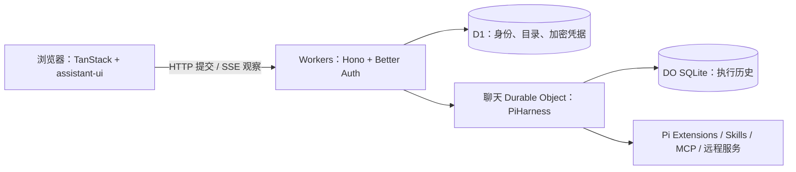

# MkHarness

**搭建拥有持久化执行与可扩展 UI 的 Agent 应用。**

[English](README.md) · [简体中文](README.zh-CN.md)

MkHarness 是一个开源 Agent 应用模板，提供流式聊天、持久化执行，以及工具与交互结果的扩展能力。基于 **TanStack、Cloudflare、Pi 和 assistant-ui**，帮助你从可运行的工程开始搭建自己的 Agent 产品。

本地启动无需登录，在界面配置自己的 API Key，同一套应用可部署到 Cloudflare。

[快速开始](#快速开始) · [核心能力](#核心能力) · [扩展](#扩展-mkharness) · [部署](#部署到-cloudflare) · [常见问题](#常见问题) · [MIT 许可证](LICENSE)

[体验在线示例](https://template.mkharness.com)：使用 Google 登录后，无需填写 API Key 即可使用 `openrouter/free`。免费额度由示例站共享，模型效果与可用性可能波动，耗尽或限流时会停止并提示，不会切换至付费模型。个人配置可覆盖默认配置。

## 快速开始

准备 **Node.js 24**、**pnpm 11.17.0** 和一个受支持的模型 API Key。本地开发不需要 Cloudflare 账号，也不需要配置 Google OAuth。

```sh
git clone https://github.com/Yukee-798/mkharness.git
cd mkharness
pnpm install --frozen-lockfile
cp .dev.vars.example .dev.vars
pnpm setup
pnpm db:migrate
pnpm dev
```

打开 **http://localhost:5173**：

1. 在输入框选择模型。
2. 点击侧栏底部的访客菜单 → **Settings → Models & API Key**，填写 **模型名**、**Base URL** 和 **API Key**，点击 **Save configuration**。
3. 发送第一条消息。

应用界面默认英文。可在 **Settings → General → Language** 切换中文，在 **Appearance** 选择浅色、深色或跟随系统。偏好保存在当前浏览器，默认主题跟随系统。

可以先试内置工具：**“请使用 `describe_text` 工具，统计‘你好世界’的字符数，只用文字回答。”** 无需搜索 Key 或 MCP 服务。

> 在界面填写的 Key 会发送给当前部署，并在服务端加密保存，用于后台执行与恢复。请在自己的部署或可信部署填写。保存 Key 不会测试连接，首次模型请求才会实际使用它。

`pnpm setup` 生成缺失的本地认证与加密密钥。重启时保留 `.dev.vars`，该文件已被 Git 忽略。本地数据存储在 Cloudflare 本地 SQLite 中。统一使用 `localhost`，不要与 `127.0.0.1` 混用。应用界面默认英文，支持在设置中切换中文；两份 README 的配置说明保持一致。

## 核心能力

- **可用的聊天应用。** 流式回复、思考过程、工具活动、模型与思考强度选择、聊天历史，以及回复和工具耗时。使用 assistant-ui、shadcn/ui 与 Tailwind CSS。
- **持久化 Agent 执行。** 每个聊天由独立 Durable Object 承载 PiHarness。支持提交排队、历史持久化和执行中断后重建；关闭浏览器只断开观察，Stop 是独立操作。
- **前后端扩展。** 服务端接入 Pi 原生工具、提示词与 hooks；浏览器注册 assistant-ui Toolkit、工具标题装饰和回复 Footer。
- **交互式生成 UI。** 可选 OpenUI 扩展支持表单、表格、图表、输入保存，以及有资源限制的 QuickJS 计算。
- **远程集成。** 可配置 HTTPS MCP 工具、静态 Skills，以及包含 submit/query/cancel 和恢复引用保存的异步服务示例。
- **免登录与个人 Key。** Better Auth 匿名会话隔离各浏览器的数据；用户自行配置模型名、Base URL 与 API Key，也可启用 Google 登录和部署默认 Key。

你可以在此基础上搭建调研助手、数据工作流，或调用自有服务的创作 Agent。MkHarness 提供应用与执行基础设施；业务工具、生图/视频服务、计费与订阅由你按需接入。

## 扩展 MkHarness

扩展是经你审核、随应用部署发布的受信任代码。服务端能力与浏览器展示各有独立的静态装配入口，工具可以接入专属 renderer，无需在核心聊天逻辑增加工具名分支。

| 扩展内容                             | 从这里开始                                                                                              |
| ------------------------------------ | ------------------------------------------------------------------------------------------------------- |
| Agent 工具、提示词片段、hooks        | [`src/extensions/server.ts`](src/extensions/server.ts) — Pi 原生 Extension                              |
| 工具 renderer、标题装饰、回复 Footer | [`src/extensions/browser.ts`](src/extensions/browser.ts) — assistant-ui Toolkit 与浏览器贡献            |
| 生成 UI、资源、输入状态、继续动作    | [`src/extensions/openui/`](src/extensions/openui/) — 完整的可选扩展                                     |
| 静态 Skills                          | [`src/server/skills.ts`](src/server/skills.ts)                                                          |
| 远程 MCP 工具                        | [`src/server/mcp.ts`](src/server/mcp.ts) — `MCP_SERVERS` 配置                                           |
| 异步服务                             | [`src/server/remote-example.ts`](src/server/remote-example.ts) — 按实际服务契约接入 submit/query/cancel |

最小工具示例可参考 [`src/server/extensions.ts`](src/server/extensions.ts) 中的 `describe_text` 及其[浏览器 renderer](src/extensions/example/browser.tsx)。[耗时扩展](src/extensions/timing/)演示如何装饰已有工具和回复。

`ENABLE_GENERATIVE_UI=0` 同时关闭 OpenUI 的工具、提示词与 UI；`ENABLE_EXAMPLE_SKILL=1` 启用静态 Skill 示例。网页搜索仅在配置 `TAVILY_API_KEY` 时注册，读取网页不需要搜索 Key。

OpenUI 表单目录已包含单值或范围滑块、开关、日期、下拉选择、复选框与文本输入。`Progress` 使用 shadcn/ui 展示实际测量或计算得到的进度。例如，以下内容在滑块改变后本地更新进度条，编辑时不调用 Agent：

```text
$amount = [40]
root = Stack([
  Slider("amount", "continuous", 0, 100, 1, null, "数值", null, $amount),
  Progress($amount[0], "目标", 100, true)
])
```

范围滑块使用两个值，例如 `[20, 80]`。进度未知时使用 `Progress(null, "等待数据")`；它不会自动追踪后台 Agent 任务。

具体接口与配置见[服务端契约](src/server/contributions.ts)、[浏览器契约](src/browser/extensions.ts)及 [.dev.vars.example](.dev.vars.example)。不包含运行时插件安装器或外部插件市场兼容层。

## 部署到 Cloudflare

应用运行在 **Workers + D1 + SQLite-backed Durable Objects** 上。首次部署需要完成以下资源与密钥配置。

### 1. 创建资源

安装依赖后执行：

```sh
pnpm exec wrangler login
pnpm exec wrangler d1 create mkharness
```

修改 [`wrangler.jsonc`](wrangler.jsonc) 的**顶层配置**：

| 配置                                            | 填写内容                                                         |
| ----------------------------------------------- | ---------------------------------------------------------------- |
| `name`                                          | `mkharness`，或自己的 Worker 名称                                |
| `d1_databases[0].database_name` / `database_id` | `d1 create` 返回的名称和 ID，替换全零本地占位 ID                 |
| `vars.APP_URL`                                  | 实际公开 origin，例如 `https://mkharness.<你的子域>.workers.dev` |
| `vars.AUTH_MODE`                                | `guest`，无需登录页面即可使用                                    |
| `vars.ALLOW_SERVER_MODEL_KEY`                   | `0`，只使用个人 API Key                                          |

保留 `DB` 和 `CONVERSATIONS` binding、`ConversationAgent` 类名及迁移定义。仓库的 `env.test` 是开发参考资源；使用该环境时替换为自己的资源。

### 2. 设置 Secrets 并部署

编辑配置后先构建，让 Wrangler 使用对应的生成部署配置：

```sh
pnpm build
pnpm exec wrangler secret put BETTER_AUTH_SECRET
pnpm exec wrangler secret put CREDENTIAL_ENCRYPTION_KEY
pnpm exec wrangler d1 migrations apply DB --remote
pnpm deploy
```

执行两次 `openssl rand -base64 32`，生成**两个独立密钥**，在对应的 Secret 提示中输入。加密密钥必须编码恰好 32 字节随机值。设置首个 Secret 时若 Wrangler 提示创建 Worker，可同意创建。

跨部署保留这两项密钥，更换加密密钥会导致已有凭据无法解密。已有安装也需要保留 Worker 名称、数据库 ID 与 Durable Object 身份。[环境在构建时选择](https://developers.cloudflare.com/workers/vite-plugin/reference/cloudflare-environments/)，修改配置或切换环境后重新构建。

### 3. 打开应用

访问部署网址，通过侧栏菜单配置个人 API Key。访客模式不需要 Google 凭据，也不需要部署默认模型 Key。

需要 Google 登录时，设为 `AUTH_MODE=account`，通过 Secrets 配置 `GOOGLE_CLIENT_ID` 和 `GOOGLE_CLIENT_SECRET`，并注册 `https://YOUR_DOMAIN/api/auth/callback/google` 回调；来源须与 `APP_URL` 一致。

Cloudflare 与模型调用分别计费，请核对账号的 [Durable Object 限制](https://developers.cloudflare.com/durable-objects/platform/limits/)。资源需要手动创建，模板不提供自动化一键部署或费用硬上限。

## 架构



**Pi 负责执行历史与结果，Query 负责读取缓存，assistant-ui 负责聊天展示。** 提交、观察与 Stop 独立。远程副作用需要供应商提供幂等或调和能力，持久化执行本身不保证操作只执行一次。

如需在自己的部署提供同样的免费默认配置，设置 `MODEL_PROVIDER=openrouter`、`MODEL_ID=openrouter/free`、`MODEL_THINKING_LEVEL=off`、`ALLOW_SERVER_MODEL_KEY=1`，将 OpenRouter Key 保存为 Worker 的 `MODEL_API_KEY` Secret。部署 Key 只允许 `MODEL_ID` / `MODEL_IDS` 明确配置的模型；个人 Key 可使用其他已注册模型。未配置付费回退。Agent 每轮推理及压缩都会消耗一次供应商请求，一次聊天可能使用多次免费请求。[OpenRouter 免费路由说明](https://openrouter.ai/docs/guides/routing/routers/free-router)。

## 常见问题

<details>
<summary><strong>访客身份和 API Key 如何保存？</strong></summary>

每个浏览器拥有经过认证的 Better Auth 匿名会话。清除 Cookie 或更换浏览器后无法找回原访客身份；不包含跨浏览器恢复和访客到账号的数据迁移。

Key 在 D1 中使用 AES-256-GCM 加密保存，不写入聊天历史。可选的“在此浏览器记住 API Key”会将明文副本保存在当前身份的 localStorage，退出时清除；不会自动重新上传。部署者持有加密密钥，可以解密凭据。最近保存的个人模型成为新提交的默认选择；同一供应商的个人 Key 优先于部署默认 Key。默认 `ALLOW_SERVER_MODEL_KEY=0` 要求用户提供 Key；设为 `1` 并配置 `MODEL_API_KEY` 可提供由部署者承担费用的默认 Key。

本地模板的默认模型列表只显示 DeepSeek-V4.1-Flash（`deepseek-flash`）。填写的模型名必须已在 Pi 原生目录中注册；可通过 `MODEL_IDS` 配置额外模型。

已知供应商地址会选择对应的 Pi 原生供应商。自定义 Base URL 必须是公开 HTTPS 地址，并支持所选供应商的 API 协议；修改自定义网关地址不会推断其他协议。拒绝重定向和私有网络地址。

</details>

<details>
<summary><strong>执行过程中修改模型设置会怎样？</strong></summary>

每条新接受的消息更新当前会话配置。Pi 在每次模型调用准备上下文前，快照模型、思考强度和不可变凭据引用。排队消息和工具后的下一轮使用当前会话配置；已准备的请求 checkpoint 在恢复时保留原版本。

单独保存 Key 或 Base URL 不更新运行中的会话，下一条新接受的消息才将该版本应用到尚未准备的调用。生成重试重新进入 prepare 时使用当前配置；压缩独立选择配置，之后的恢复和重试保留其摘要 checkpoint。

退休凭据版本最多保留七天。移除 Key 会撤销该供应商全部版本。快照凭据无效、撤销、过期或不可读取时明确失败，不静默回退到新 Key 或部署默认 Key。行为验证见[逐步骤配置测试](tests/workers/task-binding.test.ts)。

</details>

<details>
<summary><strong>模板不包含哪些能力？</strong></summary>

未内置附件、R2 素材、云端电脑/沙箱、每用户 MCP OAuth、支付和订阅。图片与视频生成需要接入服务扩展。接口可能随模板迭代调整。

</details>

<details>
<summary><strong>是否对依赖打了补丁？</strong></summary>

Pi Durable 使用未打补丁的原生逐步骤配置。`agents` 仅保留两个独立修复：Skills 结果桥接和失败 Session 缓存释放。原因及移除条件见[补丁说明](patches/README.md)。

</details>

## 开发与贡献

```sh
pnpm check                          # lint、格式、类型、unit/workerd 测试及构建
pnpm exec playwright install chromium
pnpm test:e2e
pnpm test:hmr
```

E2E 使用隔离的 `.wrangler/e2e-build` 产物运行 Cloudflare Vite 生产预览。组件夹具单独打包，不进入正常部署产物；HMR 测试独立验证开发服务器。

测试使用受控模型 I/O。请在自己的环境验收真实供应商请求、刷新/重连、Stop 和跨部署恢复；这些测试不代表真实云端验收。

欢迎[提交 Issue](https://github.com/Yukee-798/mkharness/issues) 或 Pull Request。报告问题时附上复现步骤、依赖版本与脱敏日志，不要包含 API Key 或 `.dev.vars`。

## 许可证

[MIT](LICENSE)。上游依赖与借用组件归属见 [THIRD_PARTY_NOTICES.md](THIRD_PARTY_NOTICES.md)。
