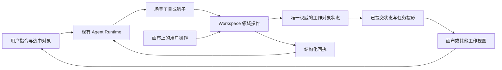

> 实施版本说明（2026-10-19）：以 [SCENARIO_WORKSPACE_IMPLEMENTATION.md](./SCENARIO_WORKSPACE_IMPLEMENTATION.md) 为接入与验收依据。首期只有 Agent 与创作画布两个入口；HTML 报告组合进普通聊天，不单独创建场景。早期章节中的报告独立场景示意不作为实施要求。

# 多形态 Agent 与场景包：架构讨论稿

日期：2026-10-19。状态：架构设计；尚未进入实施。

已确认：场景实例拥有独立身份，第一版每个实例只提供一个主聊天。布局变化不创建新实例。详细的数据链路、通信与扩展 Interface 见 [SCENARIO_WORKSPACE_PROTOCOL.md](./SCENARIO_WORKSPACE_PROTOCOL.md)；下文早期候选若与该细化稿冲突，以细化稿为准。

## 1. 用户提出的方向

- 同一 Agent 基座支持对话、分屏、画布等多种形态，内置默认布局。
- 能力可插拔、可扩展，开发者可组合成不同业务产品。
- 场景包同时集成 Agent 工具与钩子、工作空间元素、前端展示和业务请求链路。
- 用户和 Agent 能操作同一工作空间中的对象；数据、通信与执行链路是核心建设范围。
- 场景包以插件方式集成，配置后可使用，也允许二次扩展。

以上记录当前方向，不代表本文每项候选 Interface、存储方案或交付顺序已经获得确认。

## 2. 目标与三个独立概念

**场景包 Scenario Pack**：一种业务能力的完整交付，例如图像创作、报告协作、视频分镜。组合已有 Extension 贡献，并声明工作对象能力、视图和默认布局。发布包可以包含多个场景定义。

**场景实例 Scenario Instance**：一次具体工作，例如“产品 A 的封面探索”。拥有独立 `scenarioId`，绑定明确的场景定义与版本、工作空间引用、一个主聊天及执行。身份不依赖前端面板是否挂载，也不使用聊天 ID 代替。

**布局 Layout**：把会话、主要工作视图和可选辅助视图组织起来。改变布局不改变工作对象身份，也不重新创建 Agent Runtime。

布局选择由场景默认值、当前任务需要和用户偏好共同决定。自定义布局可以使用宿主提供的会话插槽、工作视图与上下文 Interface；优先复用 assistant-ui 的现有会话实现。

## 3. 当前工程中已存在的基础

以下按当前 checkout 核对，不能据此声称场景包机制已经实现。

| 已有位置                                                | 可复用内容                                                                   | 与新方向的差距                                                                |
| ------------------------------------------------------- | ---------------------------------------------------------------------------- | ----------------------------------------------------------------------------- |
| `src/server/extensions/contributions.ts`                | 原生 Extension、执行钩子、资源读取、结构化 actions、controls、文档与会话投影 | 尚无完整工作空间对象的统一读写契约；controls 当前专用于已有原生工作的带外决策 |
| `src/browser/extensions/extensions.ts`                  | assistant-ui toolkit、装饰和命名空间 panels                                  | 没有场景定义、布局贡献、工作对象与选择上下文                                  |
| `src/browser/workbench/panels.ts`                       | 面板目标校验、资源身份、会话提交入口                                         | 仅面板目标与提交能力，未表达业务对象命令                                      |
| `src/browser/workbench/panel-state.ts`                  | 打开、收起、尺寸和小型引用恢复                                               | 这是本地视图状态，不是画布/报告的服务端权威状态                               |
| `src/server/chat/session-object.ts`                     | 鉴权、提交接纳、目标解析、现有操作路由                                       | 可复用宿主路径；不应让插件再开一套 Agent 队列                                 |
| `src/server/chat/read-model.ts`                         | 原生事实与扩展投影的读取、观察                                               | 适合小型会话状态；大画布需要独立、有界的工作空间读取                          |
| `src/extensions/images/`                                | Provider Adapter、原生任务、资源回执、私有文件与消息展示                     | 目前没有画布节点、版本关系或场景项目状态                                      |
| `src/extensions/browser.ts`、`src/extensions/server.ts` | 已审核、随部署构建的显式注册                                                 | 尚未支持安装任意第三方可执行包                                                |

## 4. Module 与 Seam

尽量集中共享复杂度，不把每个概念都建立成单独引擎。

| Module                | 小型 Interface 所承担的行为                    | Implementation 的职责                                      |
| --------------------- | ---------------------------------------------- | ---------------------------------------------------------- |
| Agent Runtime（现有） | 接纳输入、执行工具/任务、观察、停止与恢复      | 保持 Pi 为执行与队列权威                                   |
| Scenario Host         | 发现可用场景、创建/打开场景实例                | 组合贡献、依赖与配置检查、实例绑定；运行中绑定版本保持一致 |
| Workspace Module      | 授权读取工作对象、执行领域操作、观察已提交变化 | 路由到业务 Adapter；统一调用身份、回执与恢复语义           |
| Layout Host           | 按布局放置会话和工作视图                       | 插槽、大小、焦点、响应式展示、本地布局偏好                 |
| 业务 Adapter          | 声明领域操作及对象投影、视图与 Agent 上下文    | 节点、图层、镜头、报告等各自模型、校验、状态变化和请求整合 |

最重要的 Seam 位于 Workspace Module 和业务 Adapter 之间。基座理解对象引用、命令、回执和可观察变化；画布 Adapter 理解节点、连线与位置，报告 Adapter 理解源码、版本与预览。不要把所有领域压成通用 node/value 数据结构。

图片 Provider 的替换仍使用现有 Provider Seam，与布局和场景注册独立。

## 5. Agent 到画布的数据链路



以“创建两个候选图节点”为例：

1. 模型调用场景的领域工具，传入已绑定的工作空间引用和业务参数。
2. 服务端校验场景、对象归属、操作权限、请求幂等键和适用的版本前提。
3. 创建具有稳定 ID 的节点，记录待生成状态和原生任务关联。
4. 前端观察到已提交状态，呈现节点；不要求用户页面在线，也不等待 DOM 回执才创建节点。
5. 原生任务调用图片能力，结果存为受控资产；节点关联产物，状态更新为完成或失败。
6. 工具向模型返回可验证的节点/操作引用及明确状态；消息展示由扩展 toolkit 承担。
7. 用户选中 B 后发出新指令，服务端验证并冻结该次选中对象的引用，再交给执行链路。

长任务可以先返回已接纳的操作引用，前端继续观察状态；如果该轮模型必须消费生成结果，则由原生任务机制等待结果。业务包明确选择语义，接纳和完成使用不同状态。

创建对象、记录操作回执与原生任务关联采用同一原生事务。当前 `images/runtime.ts` 已使用 `api.commit` 内的 `tx.doc` 与 `tx.createTask` 完成原子关联；Pi 本地 README 也明确支持文档与任务同一 commit。场景实现仍须通过公开 Interface 验证故障恢复，不在事务回调中调用外部 Provider。

现有 `generate_image` 工具回执不是画布协议。组合时需要明确的图片生成能力 Interface 与节点关联 Adapter；不能假定可以直接在一个工具中任意调用另一个工具并共享其内部状态。

## 6. 数据与通信的三种语义

### A. 持久化领域操作

例如 `canvas.addNode`、`canvas.moveNodes`、`report.replaceSection`。无论来自工具还是用户操作，都经过同一领域处理 Interface，取得相同校验、版本和回执语义。

基座提供传输和调用上下文，业务 Adapter 定义有限的可调用操作与输入结构。模型不获得任意数据库写入、任意 URL 请求或浏览器代码执行能力。

### B. 触发 Agent 的意图

例如“基于选中节点生成变体”“重做第二镜头”。以现有结构化 action/source 思路进入同一个提交、队列和执行链路。前端无需自行制造一段无依据的隐藏提示词来模拟工具。

选择上下文在提交时冻结；排队后执行前，重新检查目标是否存在、权限是否仍有效、版本是否满足前提。当前 UI 改选其他对象，不改变已提交任务的目标。

### C. 本地展示效果

例如聚焦节点、缩放画布、打开标签、滚到章节。视图可以根据已提交操作结果建议执行；不承担创建作品等业务事实。

用户关闭工作区或有多个客户端时，业务结果仍成立。本地聚焦无需跨设备重放；需要用户处理的阻塞事项则保存为可恢复状态，不能只发一次通知。

执行钩子可以调用受控领域操作或读取最新业务上下文，但钩子自身不增加一套执行队列；必须可靠发生的状态变化应写入正式事务/任务链路，不能依靠可能被跳过的观察回调。现有鉴权与模型调用检查仍位于当前权威路径。

## 7. 最小的通信契约候选

以下只表达需要承担的行为，不冻结 TypeScript 类型或命名：

- **read(ref)**：读取有界快照或一页对象，返回修订标识。
- **execute(ref, operation, payload, requestId, precondition)**：执行业务操作，返回已提交回执，或已接纳且可查询的原生操作引用。
- **watch(ref, cursor)**：观察已提交更新；游标失效或出现缺口时重新读取，不假定消息恰好交付一次。

鉴权主体和可信目标由宿主确定，不能由浏览器 payload 中的 ownerId 决定。任务创建、工具执行和凭据使用依然由现有原生执行链路负责。

可靠性约定属于 Interface：

- 重试同一请求键不重复执行；先识别已有回执，再判断版本前提。键相同而内容不同则冲突。
- 对象状态有适合该领域的并发前提；冲突返回最新信息供重新决策，不静默覆盖人工修改。初期可使用较粗修订号，不预设必须 CRDT。
- 任务迟到结果绑定原操作与输入版本；对象已删除或已被替换时，不自动覆盖当前选择或复活节点。
- 快照与观察具有修订关联，重连可以恢复；不要求新建一个通用 Event Sourcing 系统。
- 多次拖动可以合并提交；本地乐观显示须有 pending/失败处理，临时拖动位置不宣称已持久化。
- 大文件保留在受控资产存储，通过引用按需读取；不塞进聊天历史、实时状态帧或布局存储。

## 8. 状态归属

| 内容                               | 权威归属                             |
| ---------------------------------- | ------------------------------------ |
| 会话、执行、队列、任务恢复         | 现有 Pi Runtime                      |
| 工作对象及业务操作回执             | 场景明确指定的服务端权威存储         |
| 图片、视频和模型文件               | 受控资产存储，模型/视图持小型引用    |
| 当前选择、缩放、打开视图、宽度     | 默认本地视图状态；需要协作时另行定义 |
| 安装配置、可用能力和 Provider 凭据 | 宿主配置与凭据模块，按现有权限访问   |

首期建议每个场景实例复用一个运行宿主与一个 Pi Session，工作对象使用 Session 作用域的文档家族，以实例/工作区身份寻址；主聊天是该 Session 的一段原生会话。现有会话投影仅接受 conversation 文档，需要新增工作区读取与观察 Adapter。未来多聊天需要扩展目录与执行定位，不能把多份会话文档复制当作共享项目实现。

复制聊天/分支、删除聊天与删除项目、场景切换、包升级和卸载的数据保留规则都属于公开契约。具体规则需确定后实施。仅切换布局不改变归属，卸载视图不等于删除作品。

## 9. 场景包包含什么

建议用一次包声明关联已有贡献，复用当前注册机制，避免为每种能力各写一份彼此独立的安装名单。

| 包内容                                      | 目的                               |
| ------------------------------------------- | ---------------------------------- |
| 标识、版本、宿主兼容范围                    | 可发现、可检查、可绑定             |
| 场景定义、默认布局、允许的视图              | 声明产品形态                       |
| Agent 指令、工具、任务及必要钩子            | 声明执行能力                       |
| 工作对象与领域操作、数据版本及迁移          | 支持持久化业务状态                 |
| 消息 renderer、工作视图与选择上下文 Adapter | 将对象操作与会话连起来             |
| 依赖、配置结构、能力要求和初始内容          | 配置后可消费，缺配置时给出明确原因 |
| 资源与导出贡献                              | 读取受控产物，交付结果             |

示意包目录：

```text
image-canvas/
  manifest.ts      包身份、依赖与场景声明
  contracts.ts     对象引用、操作和选择上下文
  server.ts        领域处理、原生工具与任务贡献
  browser.tsx      画布视图、消息 renderer
  state.ts         数据结构与迁移
```

这不是必须固定的目录协议。真正的交付标准是使用者接入包、配置 Provider 后，可以跑通具体业务闭环，不需要重写宿主。

**加载方式需要区分两步。** 首先可交付随部署构建的可信场景包，包括包管理器依赖与本地包。这与当前静态导入方式一致。运行时从市场下载并执行任意第三方前后端代码，还需要代码隔离、权限和服务端执行载体的明确方案，不应把它作为“有 manifest 就已支持”的能力。此前插件市场仍是入口占位，本文不自动扩大其实施范围。

## 10. 默认布局与两类能力验证

建议先提供三个 Layout Adapter：

1. `chat`：会话为主，行内交互，媒体可开灯箱。
2. `split`：会话与主要工作视图并排，适合报告协作、模型检查和浏览器观察。
3. `studio`：主要工作视图占大面积，会话可收窄/收起，适合画布和分镜。辅助属性视图按场景贡献。

专注/最大化是布局状态，不必额外成为一个产品模式。横竖分屏和窄屏降级由宿主处理，也允许开发者提供自定义 Layout Adapter。

以创作画布入口和普通聊天内的报告能力验证抽象：

- **图片画布**：创建节点 → 原生生成任务 → 节点关联资产 → 选择节点发起变体 → 刷新恢复。
- **报告协作**：生成报告 → 阅读与图表交互 → 查看或恢复历史版本 → 导出 HTML；暂不支持报告选区引用编辑。

前者包含异步媒体与空间对象，后者包含结构化内容编辑。两者能共用通信、选择上下文与生命周期，才说明基座的 Seam 真实有效。视频、3D、云电脑可以随后接入；不先建设一套未经场景验证的通用节点引擎或万能编辑器。

## 11. 候选交付顺序

1. 明确场景定义、实例身份、首期数据作用域和默认布局。
2. 打通一条领域操作链，提供鉴权、幂等、版本、快照/观察与结构化 Agent 意图。
3. 完成图片画布场景包与普通聊天中的报告能力包，检验是否需要修改宿主才能接入。
4. 补齐打包消费、配置诊断、数据升级与移除契约，给出可复制开发文档。
5. 有真实需求后再扩展跨会话项目、共享协作、第三方运行时安装和更多生产场景。

验收通过公开 Interface：Agent 和用户操作同一对象，重复请求不重复创建，页面关闭后任务继续，刷新和重连能恢复，迟到结果不会覆盖更新版本；布局切换保持会话与对象身份；第二场景只增加包与配置即可接入。

已确认首期每个独立场景实例只有一个主聊天。实现接入说明与当前验收结果分别见 SCENARIO_WORKSPACE_IMPLEMENTATION.md 和 SCENARIO_WORKSPACE_VERIFICATION.md。
