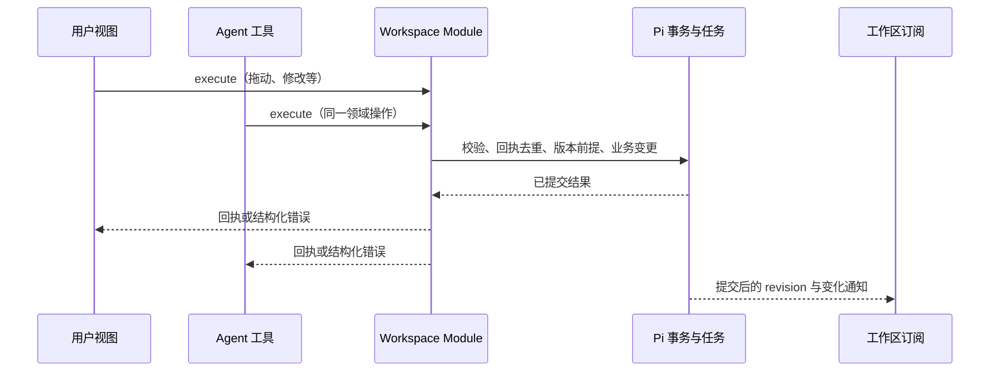

> 实施版本说明（2026-10-19）：以 [SCENARIO_WORKSPACE_IMPLEMENTATION.md](./SCENARIO_WORKSPACE_IMPLEMENTATION.md) 为接入与验收依据。首期只有 Agent 与创作画布两个入口；HTML 报告组合进普通聊天，不单独创建场景。早期章节中的报告独立场景示意不作为实施要求。

# 多布局 Agent 基座：场景、工作区与扩展契约

日期：2026-10-19。状态：细化设计，非已实现能力。本文的类型与路径是候选契约；代码片段用于说明语义，未作为 SDK 编译验证。

## 1. 已确认约束与本次推荐

用户已确认：场景实例拥有独立身份；第一版一个实例只有一个主聊天。基座支持多布局、可插拔场景包，重点打通 Agent 与工作区的数据、通信和操作链路。

本文推荐：一个实例首期对应一个运行宿主，复用当前 ChatSession/Pi 实现。工作区数据、命令回执和原生任务在同一个 Pi Session 内提交；会话与工作区分别观察。先支持可信构建式场景包，再独立设计运行时市场安装。其余细节是待评审建议。

## 2. 身份与作用域

```text
Scenario Pack：可安装的代码与声明
  Scenario Definition：包里的一种业务形态
    Scenario Instance（scenarioId）
      主聊天（mainChatId → 实际原生 conversationId）
      主工作区（workspaceId）
        领域对象（objectId + kind + 领域版本）
      原生执行（runId / taskId）与受控资产引用
      本地视图偏好（layout / selection / viewport）
```

- `scenarioId` 是产品项目身份；`mainChatId` 是对话身份；`workspaceId` 是业务状态入口。首期每实例一个主工作区，其内部可有多种对象和多个视图。
- 浏览器携带场景与对象引用；运行宿主、owner、实际原生目标和可用权限由服务端解析。浏览器不选择任意 Runtime 或 Task 所有者。
- 改标题、切布局、收起聊天、关闭页面都不改变以上身份。
- 工作对象引用为 `{workspaceId, kind, id}`；版本前提与引用一起提交，但对象身份不随版本改变。
- fork 的会话历史不能自动获得当前工作区的写权限。首期只开放主聊天的场景写入；需要未来分支或子 Agent 写入时，显式授予受限工作区能力。

### 物理存储推荐

| 信息                                                    | 位置与权威                                                |
| ------------------------------------------------------- | --------------------------------------------------------- |
| 场景目录、归属、创建回执、运行定位与生命周期 generation | D1；宿主校验当前 generation，防止删除后迟到请求重新初始化 |
| 场景定义绑定、工作区头、业务文档与对象、操作回执        | 同一运行宿主内的 Pi Session 作用域文档/文档家族           |
| 会话、模型输入、工具、生成任务与任务检查点              | 同一 Pi Session 内的原生会话与 Task                       |
| 大型媒体                                                | 私有资产存储；对象保存受控引用                            |
| 布局尺寸、视图缩放、未提交选择                          | 浏览器，按账号/实例/视图隔离                              |

`runtimeKey` 是宿主内部稳定定位，不等于 `mainChatId`。现有 `getByName(chat.id)` 与 ChatActor 鉴权需通过可信运行定位改造；不能只新增一个场景表后继续假定聊天就是存储身份。

首期不新增另一个调度器或 Workspace DO。未来同实例增加聊天时，可先复用同一 Pi Session 的多个原生会话；产品目录和路由仍需届时扩展，不能宣称已支持跨聊天。外部业务数据源可由 Adapter 接入；跨存储原子性不属于默认保证。

### 创建与删除

创建请求以 `(owner, requestId)` 幂等绑定场景定义版本、配置哈希及生成的实例 ID。D1 原子创建 provisioning 目录及主聊天关系；宿主幂等建立原生主会话、绑定和初始工作对象，成功后目录转 active。初始化失败保留可重试 provisioning，不接受业务写入。D1 与宿主不是一个事务；丢失确认时重开校验已有原生绑定，再补目录状态，不重复创建实例。

普通重命名/整理聊天不删除作品。首期禁止单独物理删除实例的主聊天，返回 `scenario_main_chat_required` 并提供删除实例动作。删除在宿主先提交原生 tombstone，作为后续业务写入被禁止的生效点；然后补 D1 deleting 目录并停止本地执行、清理文件与宿主。每个业务写事务都在事务内检查 tombstone 和绑定 generation，不能只在进入路由时检查。目录更新失败可恢复，不解除宿主的删除标记。外部 Provider 可能仍在运行；迟到结果不能复活实例。

## 3. Module 与扩展 Seam

| Module             | 对调用方承担的 Interface             | 内部责任                                                 |
| ------------------ | ------------------------------------ | -------------------------------------------------------- |
| Scenario Host      | `create / open`                      | 可信定位、实例绑定、配置与兼容检查、主聊天关联           |
| Workspace Module   | `read / execute / watch`             | 命令校验、权限、事务、回执、并发前提、有界读取与更新通知 |
| 现有 Agent Runtime | 现有提交/执行/观察/停止 Interface    | Pi 队列、原生任务与恢复；补充已授权的场景上下文          |
| Layout Host        | 注册布局与渲染插槽                   | 一次挂载会话与工作数据 Provider、布局偏好、响应式展示    |
| 场景 Adapter       | 领域操作、查询、上下文投影与工作视图 | 节点/段落/镜头等业务规则；通过原生任务整合外部能力       |

Workspace Module 的 Depth 来自将鉴权、幂等、事务、冲突、回执与观察集中起来。它不判断一个节点是什么，也不代替视频业务编排。Layout Host 不拥有作品存储；业务 Adapter 不新建 Agent Runtime。

## 4. 共享数据契约

```ts
type ObjectRef = { workspaceId: string; kind: string; id: string };
type ObjectVersion = { ref: ObjectRef; version: string };

type WorkspaceCommand = {
  requestId: string;
  operation: string; // 如 image-canvas.moveNodes
  input: Json; // 由该操作的 schema 校验
  preconditions: ObjectVersion[]; // 操作声明必需哪些前提
};

type CommandReceipt =
  | { kind: 'committed'; requestId: string; revision: number; result: Json }
  | { kind: 'accepted'; requestId: string; revision: number; operationId: string };

type WorkspacePort = {
  read(query: string, input: Json, cursor?: string): Promise<WorkspacePage>;
  execute(command: WorkspaceCommand): Promise<CommandReceipt>;
  watch(onFrame: (frame: WorkspaceFrame) => void): () => void;
};
```

这是绑定当前实例/工作区的 Port，调用者不反复传 owner 或运行宿主。查询、操作和输出都按命名空间注册且有大小限制。`Json`、`WorkspacePage` 等详见语义章节，代码片段不代表可以提交任意 JSON。

`revision` 是查询快照覆盖的原生提交水位，沿用当前 `app_read_meta.revision` / commit publication 的 `seq`，允许因为同宿主其他提交而前进。ObjectVersion 才是业务对象的并发前提；`schemaVersion` 是数据格式版本；包版本/场景定义版本是代码兼容身份。这几种版本不能互换。读取水位变化不使未变化对象的编辑失效。

回执核心（请求哈希、提交结果或 operationId）在事务内持久化；响应的 revision 是提交后读取的覆盖水位，可在重试时更新，不需要在事务里预猜原生提交序号。

回执说明已提交或已接纳。异步操作状态通过 `operationId` 读取/观察，不能把 accepted 展示为已生成成功。

## 5. 领域操作：用户与 Agent 共享的写入链



服务端调用上下文由宿主注入：实例、工作区、调用主体、能力、generation、包绑定、原生输入/任务关联和取消信号。用户与 Agent 共用业务处理器，但能力可以不同，例如只允许用户批准发布。

单次操作流程：

1. 校验归属、生命周期、已绑定操作及当前可用权限，解析并限制输入。
2. 在原生事务内检查该工作区的 requestId 回执。相同内容重试返回已有回执；相同键不同内容返回 `request_conflict`。
3. 对新请求验证对象版本、操作要求的全部前提和业务规则。适用场景使用对象版本，避免所有拖动都冲突于无关生成。
4. 业务 Adapter 在该事务内修改受管文档；可创建受许可的原生任务。宿主同时记录回执；原生提交推进读取水位。
5. 事务提交后才对外返回、通知视图。事务失败则作品、任务关联和回执均不提交。

处理器 Interface 候选为 `apply(input, { tx, scope, preconditions }) → result`。`tx` 是命名空间内的工作数据与原生任务能力，不向浏览器暴露；原生任务创建仍须绑定现有执行权限与预算。首期均为可信插件代码，这个 Facade 不等于对任意恶意代码的隔离。

事务回调不发起 Provider 请求、不写外部文件、不创建 DOM、不发送一次性 UI 消息。外部副作用由持久化原生任务负责。写多个工作区或外部系统不自动享有该事务保证。

回执保留与请求重放窗口必须有上限：建议浏览器命令采用宿主可验证期限的幂等票据，期限内保留完整回执；过期原请求返回 `request_expired`，不因回执清理而当作新请求执行。原生工具以完整任务身份派生稳定请求键，保留到该 Task 不再可恢复；调用 ID 单独使用不足以去重。具体期限作为实现配置评审，不能靠客户端时钟保证。

## 6. 长任务：创建节点与生成图片

图片画布 Adapter 的 `generateVariants` 是一个长期业务操作。它组合图片生成能力与节点语义，不通过前端模拟模型调用，也不依赖字符串解析现有 `generate_image` 的消息展示。

### 开始事务

- 从操作 requestId 派生稳定 operationId/节点 ID。
- 校验参考图与节点的内容版本，冻结本次生成输入和 Provider 配置身份。
- 创建占位节点、原生 Task、节点与 Task 的关联，以及 accepted 回执。
- 一次提交，推进读取水位。

同一 Pi commit 中修改文档和 `tx.createTask` 已由当前图片扩展示范。接下来需把可组合的图片任务能力作为真实 Seam 提取，供行内图片工具和画布工具两个 Adapter 使用。

### 执行与发布

原生 Task 保存提交/轮询/存储检查点。Provider 支持幂等时使用其幂等键；不支持时沿用提交不确定状态，不能承诺端到端 exactly-once 或自动重新付费生成。

大文件先按稳定资产身份写入受控存储，再在原生事务中发布可读取引用并完成 Task。存储写入与 Pi 不在同一事务：崩溃后检查已有文件，未引用文件由有界回收流程清理。

发布时再次检查实例 generation、原操作、目标节点及该任务所依赖的内容版本：

- 有效：关联资产，提交已完成事实，推进读取水位。
- 节点已删除：不恢复节点；保存任务已结束及结果未挂载的可解释状态，清理资产。
- 输入已被修改或操作被替换：结果不覆盖新内容；作为原操作结果保留或标为 superseded，由场景策略决定。
- 仅移动了节点：不应使图片失效；Adapter 应把生成依赖的内容版本与位置变化区分。

异步状态来自原生 Task 和关联文档的投影，不另建可执行的任务队列。操作目录只是关联与回执，不再拥有调度权。读取和观察都必须纳入关联 Task 的原生变化，包括自动停止、缺失任务定义和重启后的状态；不能只在业务任务主动写工作文档时才更新视图。

### 等待和停止

需要模型在同一轮消费结果的工具，使用原生 `waitForTask`；可以后台完成的操作，工具返回 operationId 并说明尚未完成。最终状态仍可在工作区观察，即使该次回复已经结束。

工具创建的任务默认由工具/本轮执行拥有；显式直接生成动作创建的任务由对应主会话和操作关联，并需在场景中声明可用。复用现有授权、额度和调度唤醒路径。浏览器 execute 成功创建原生任务后须唤醒并重设现有宿主 alarm，仅写入待执行记录不能视为启动完成。

停止本轮 Agent、取消特定操作、关闭工作视图是三个动作。具体任务停止遵循原生 ownership；远端取消与退款依据 Provider 能力。视图卸载仅结束观察。

## 7. 工作区到 Agent：选中对象与意图

工作区支持两条用户操作路径：

- `workspace.execute`：明确的领域操作，例如移动节点、修改文字，通常不启动模型。
- `conversation.submit(text, source)`：让 Agent 工作，例如基于选中图片生成变体，进入既有 admission/Inbox/执行链。

意图沿用现有 extension action/source 形式，候选 payload：

```json
{
  "action": "extension_action",
  "extensionId": "image-canvas",
  "name": "iterateSelection",
  "payload": {
    "workspaceId": "ws_…",
    "selection": [{ "kind": "image-node", "id": "node_B", "version": "content:7" }]
  }
}
```

宿主从主聊天绑定解析实例，交叉核对 workspaceId；选择不是权限证明。包的 Selection Adapter 负责解释不同对象，例如报告选段需要稳定段落 ID、范围及文本校验，图片蒙版需要对应图片内容版本和有效坐标。

### 接纳与执行时机

1. 前端将当前选择附到输入框，用户可以查看/移除。选择随该次发送冻结，之后的改选不改变已发送目标。
2. 服务端解析、鉴权并生成有界的 FrozenContext。涉及内容的引用需要有不可变资产/版本，或保存必要的小型内容；不能只记录一个会随时间改变的当前值。
3. 接纳事务中重新验证版本前提，把 FrozenContext 与已接纳输入存入同一原生回执。现有 `actions.normalize` 在事务前运行，不能单独承担原子冻结保证，需补充事务内验证/冻结位置。
4. 排队后执行时重新检查权限和目标。首期编辑意图默认 strict：目标内容发生变化就提示选择已过期，不静默切换到最新版。允许基于旧素材继续生成的场景必须显式声明 snapshot 语义。
5. 工具每次写入继续检查当前领域前提。运行上下文绑定已接纳输入与 nativeTask，不读取“用户此刻选中的节点”。

### 模型能看到什么

每次模型步骤使用有大小限制的场景摘要：可操作对象类型、当前相关对象与任务摘要、已冻结选择、版本及可调用工具。详细内容通过只读领域工具按需读取；不把整张大画布、文件字节、登录令牌或逐帧拖动数据写入提示词。

接纳时必需的上下文进入已保存输入；可选的最新摘要由受控上下文投影提供。关键权限在现有宿主模型调用/工具执行路径检查。当前 `beforeSubmit` 仅在空队列新提交时执行，不可用作所有输入的接纳校验；原生观察钩子也不能代替可靠接纳或权限检查。

## 8. 工作区观察与通信传输

### 两条独立观察链

| 链路                 | 生命周期           | 负责数据                       |
| -------------------- | ------------------ | ------------------------------ |
| 现有会话 AG-UI / SSE | 当前 run 与历史    | 消息、工具展示、执行与队列     |
| 新增工作区 SSE       | 工作区视图可见期间 | 业务对象更新通知、操作状态定位 |

工作区通知独立于 runId。没有模型运行时，人工拖动也会变化；模型回复结束后，后台任务也可能继续。两条链共享实例身份与同一原生存储，不同步复制权威数据。

### 首期使用快照与失效通知

不先实现任意 JSON Patch 或永久事件日志。定义最少帧：

```ts
type WorkspaceFrame =
  | { type: 'ready'; revision: number }
  | { type: 'changed'; revision: number; refs?: ObjectRef[] }
  | { type: 'reset'; reason: 'overflow' | 'binding_changed' }
  | { type: 'closed'; reason: 'deleted' | 'unavailable' };
```

`changed` 表示需要重新读取相关查询，不包含命令，也不会重放业务副作用；refs 可以缺省，缺省时使该工作区全部查询失效。通知允许合并，revision 不必连续。前端只接受更高 revision，去重并合并读取请求。

连接时先登记原生 commit 订阅，再原子读取当前 revision，发送 ready。客户端比较自己的快照，落后则重读；订阅期间缓冲变化，去掉已覆盖修订。工作文档和关联 Task 的提交均触发 changed；可用关联索引过滤无关提交，索引必须与原生事实一致。快照加载中若收到更高 revision，完成后继续补读。慢客户端超出缓冲返回 reset，重连总能以当前快照恢复。心跳可携带当前 revision，修复最后一条通知丢失；不承诺每条中间变化都被看到。

每个查询返回 `{revision, data, nextCursor}`。一次快照中的受管文档、关联 Task 与水位在同一个原生只读提交范围内读取，不能分别读取后将较新水位贴到旧数据上。派生索引只负责定位，实际事实通过 Pi 公共读取 Interface 验证。

大对象集合分页，cursor 绑定查询与快照 revision；分页过程中版本改变则提示重读。首期对单工作区对象数、页大小和结果字节数设置显式上限。未来需要大规模画布时，可演进稳定对象读取或增量协议，不放宽成无限全量推送。

布局切换复用一个按实例/工作区键控的数据订阅；视图隐藏可以释放观察并保留缓存，重新可见后核对 revision。HTTP 断开不代表命令失败：execute 以同一 requestId 查询/重试，避免重复操作。

### 候选 HTTP 路径

```text
POST /api/scenarios                         创建实例，幂等 requestId
GET  /api/scenarios/:sid                    实例、主聊天、能力与视图声明
GET  /api/scenarios/:sid/workspaces/:wid     命名查询与分页
POST /api/scenarios/:sid/workspaces/:wid/commands
GET  /api/scenarios/:sid/workspaces/:wid/events
POST /api/conversations/:mainChatId/runs    沿用结构化 source 提交
```

大文件走受控资源路径，鉴权必须证明场景与资产归属。当前图片资源依赖可见工具回执；未来后台生成可能没有对应消息回执，需要新增工作区资产授权 Adapter，不能直接把私有文件转为公开 URL。

### 专用实时通道

WorkspacePort 承担持久化业务状态。云桌面的实时画面、浏览器按键、视频播放流等由对应 Adapter/Provider 的专用通道承担，例如流媒体或远控连接；不逐帧塞入工作区 SSE 或聊天消息。宿主按实例和能力授权建立短期连接，控制权、需接管状态、最终结果等可恢复事实仍通过工作区/原生任务表达。高频通道不是首期两个示例包的交付内容，但公共契约不要求所有交互都变成持久化命令。

## 9. 场景包扩展 Interface

### 三个入口，单一声明来源

```text
pack/manifest      可序列化身份、场景定义、兼容范围、依赖、配置声明
pack/server        Workspace 定义、领域工具/任务、Agent 指令与上下文贡献
pack/browser       工作视图、Selection Adapter、消息 toolkit、可选布局
```

server/browser 只通过注册名关联，后端密钥与实现不进入前端 bundle。场景定义引用已有 Extension，不重新实现原生插件注册。启用某包不等于每个场景的模型都能调用该包全部工具：按实例定义解析能力，和宿主/账号许可取交集。

建议新增宿主贡献字段，并保持原生 `Extension` 字段原样：

| 宿主扩展字段                          | 需要承担的契约                                                         |
| ------------------------------------- | ---------------------------------------------------------------------- |
| `scenarios`（manifest）               | 默认布局、默认工作区类型、允许视图、能力需求与配置版本                 |
| `workspaces`（server）                | 数据 schema/init/migrate，命名查询、领域命令与受限上下文投影           |
| `views`（browser）                    | 工作视图 Adapter，收到绑定后的 WorkspacePort/ConversationPort/ViewPort |
| `selections`（browser + server 校验） | 把本地选择转换为结构化 source，并由服务端验证/冻结                     |
| `layouts`（browser，可选）            | 消费宿主插槽，注册自定义摆放与窄屏降级                                 |

概念注册示例：

```ts
// manifest 中只放可序列化声明
scenario({
  id: 'image-canvas/create',
  version: 1,
  workspace: 'image-canvas/board',
  defaultLayout: 'builtin/studio',
  views: { primary: 'image-canvas/canvas', inspector: 'image-canvas/properties' },
  extensions: ['images', 'image-canvas'],
});

// server 领域操作；schema、权限与版本要求也是 Interface 的一部分
command('image-canvas.moveNodes', {
  input: moveNodesSchema,
  callers: ['user', 'agent'],
  preconditions: 'objects',
  apply: moveNodesInTransaction,
});
```

工具只暴露适合模型使用的领域语义，例如“生成两个候选”。用户拖动用位置命令。两者可以组合相同底层处理器，注册操作不必全部自动成为模型工具。

宿主装载时检查命名冲突、引用完整性、前后端版本与配置需求。场景绑定保存定义/数据版本及实现兼容身份；部署不兼容代码时应明确 unavailable/read-only，不能默默解释旧任务为新任务。初期不承诺同进程同时加载任意历史版本。

升级需停止新写入、处理活跃任务并进行原子数据迁移后更新绑定；失败保留旧状态。单纯关掉扩展不删除已存作品。可卸载的前提是活跃任务的处理和资源保留策略已明确。

## 10. 多布局与前端运行位置

```text
ScenarioProvider                 实例绑定、唯一工作区数据与选择上下文
  ConversationRuntimeProvider    唯一 assistant-ui 主聊天运行时
    LayoutHost
      conversation slot          现有 Thread、Composer、工具展示
      primary slot               画布 / 报告 / 3D Viewer / 浏览器
      inspector slot（可选）      所选对象参数
```

三个内置 Layout Adapter 为 `chat / split / studio`；最大化是布局状态。自定义布局只消费插槽与受限 Port，不能暗中创建第二个提交、观察或 Pi 执行链。

同一工作区的画布视图和属性视图读取相同查询缓存并执行相同命令。当前选择在本地共享；只有提交操作/Agent 输入时才冻结必要选择。视图 mount/unmount 可以调整，实例数据与主聊天 Provider 保持稳定。

ViewPort 提供 `focus(ref)`、`setSelection(selection)`、`openView(viewId, target)` 等有限展示能力；目标和命名空间须验证。Agent 的业务结果可带可选展示建议，用户当前焦点优先，历史消息重放不自动抢焦点。重要的用户确认由持久化原生状态表达，不依赖 UI 建议是否被消费。

所有聊天相关展示沿用 assistant-ui；应用 UI 沿用 shadcn/ui 与 Tailwind。本文没有选择画布或编辑器库，相关技术选型应在实际 Adapter 实施时按需求验证。

## 11. 与现有代码的接续点

| 现有位置                                          | 需要演进的内容                                                                                    |
| ------------------------------------------------- | ------------------------------------------------------------------------------------------------- |
| `src/server/chat/directory.ts`、routes、ChatActor | 场景目录与可信 runtime 定位，主聊天关系及生命周期；保持已有提交/删除的去重语义                    |
| `src/server/chat/session-object.ts`               | 绑定场景、命名命令/查询路由、输入冻结、原生任务唤醒与新的工作区观察                               |
| `src/server/chat/documents.ts` 与 storage         | Session 作用域工作文档/回执；只经 Pi 公共提交 Interface；派生查询索引与原生写入同事务             |
| `src/server/extensions/contributions.ts`          | 追加宿主工作区贡献，不把当前 controls 改成任意业务命令；不重建 Pi Extension                       |
| `src/server/extensions/state.ts`                  | 保留会话小型投影；新工作区 Session 文档使用独立读取/观察，不挤入原来的 conversation-only 文档投影 |
| `src/shared/contracts.ts`、admit/place            | 接纳时结构化选择与上下文的原子冻结，执行时失效处理                                                |
| `src/browser/extensions/extensions.ts`            | views/layouts/selection 贡献与版本检查                                                            |
| `src/browser/workbench/`                          | 原面板作为可复用视图承载；布局与工作对象数据拆开                                                  |
| `src/extensions/images/`                          | 将受控原生生成任务提取为可组合能力，增加工作区资产读取授权方式                                    |

旧有普通聊天可映射至内置 chat 场景；实际迁移必须保留 ChatId、目录创建回执和原生目标，不能直接重建会话。具体迁移脚本属于后续实施计划。

## 12. 两个场景与契约验收

| 验证链路                  | 必须观察到的行为                                                       |
| ------------------------- | ---------------------------------------------------------------------- |
| 图片画布创建候选          | 节点、回执与任务关联一起提交；同请求重试不重复节点或原生任务           |
| 报告选段编辑              | 用户与 Agent 经过同一领域校验；段落已变化时返回冲突                    |
| 队列里的选图请求          | 发送后改选其他图不改变任务目标；执行前版本失效可解释                   |
| 无 Agent 运行时拖动       | 工作区另一视图通过独立订阅更新，聊天流无需启动                         |
| 生成中关闭/刷新           | 原生任务继续；重开从快照与操作投影恢复                                 |
| 节点删除/替换后迟到结果   | 不复活节点，不覆盖新版本                                               |
| 命令确认丢失/失效通知丢失 | 同键恢复回执；ready/快照恢复到当前 revision                            |
| 拖动与生成同时进行        | 位置变化不会错误使生成内容失效                                         |
| 布局切换                  | 同一 scenarioId、workspaceId、主聊天与原生任务；无重复提交或第二运行时 |
| 包关闭/不兼容部署         | 明确不可用状态；不执行未知历史代码，不静默删除作品                     |
| 删除与迟到初始化交错      | generation 与生命周期检查拒绝写入和重新初始化                          |

首期优先完成可信场景包注册、独立实例、三个布局、WorkspacePort 与两个示例场景。多聊天、多人协作/CRDT、任意嵌套布局编辑器、在线安装第三方可执行代码，以及完整视频剪辑器继续作为后续扩展范围。

## 13. 当前设计的证据与限制

- 当前 `src/extensions/images/runtime.ts` 已在同一 `api.commit` 中访问 `tx.doc` 并调用 `tx.createTask`；本地 Pi Durable 1.3.0 README 的 Concepts/Commit 段也明确支持文档、条目和 Task 的原子提交。
- `src/server/chat/documents.ts` 已使用 Session 作用域文档家族；因此上述存储推荐不要求发明另一个 Agent 数据运行时。
- 当前 `createExtensionProjection` 仅接收目标 conversation 的已声明文档，当前 AG-UI 观察以 runId 结束；不能声称现有投影已经支持实例工作区。
- 当前目录和宿主鉴权与 ChatId 绑定，独立实例运行定位需要实质改造。本文没有将“数据类型可定义”当成“链路已实现”。
- 存储、浏览器和真实 Provider 验收仍应分别完成。本文是架构与契约设计，没有新增实现或执行验收测试。

## 14. 报告形态、依赖与导出补充

后续讨论已确定：报告由 AI 自由生成 HTML/CSS/JS，可包含交互图表；用户阅读、使用报告内交互并下载 HTML，不采集文字选区或章节点击，不提供选区引用编辑或人工富文本编辑器。AI 直接更新当前作品，并保留版本恢复。报告运行采用轻量 iframe sandbox 与通信 Adapter，不引入 Sandpack 自托管服务。

用户进一步提出：最终交付一个 HTML 文件，第三方库可以由预设报告模板通过 CDN 引入。因此将“所有报告依赖必须随应用静态部署”调整为：宿主预览与通信代码随应用发布，报告的第三方脚本和样式按模板声明加载。

### 模板与作品版本

- 模板声明身份、版本、固定版本的脚本/样式 URL、必要加载顺序与基础样式。ECharts 等库可以使用 CDN；模板决定依赖，模型在该模板能力范围内编写报告与交互。
- 每份报告版本冻结模板身份与实际依赖清单，模板升级不自动改变旧报告。
- 报告内容、图表数据和交互初始化逻辑包含在 HTML 内，不要求打开者登录本应用或从工作区读取数据。
- iframe 预览按相同依赖清单加载资源。CDN 可用性影响图表/样式展示；提供明确加载失败状态，不将其误报为 Agent 未生成报告。

### 单文件 HTML 导出

1. 读取用户指定的已提交报告版本及其依赖清单。
2. 从该版本的源码与数据生成完整 HTML，包含 doctype、head、body、脚本和样式引用。保留报告所需交互代码。
3. 报告使用的私有/上传图片等受管资产导出时内联，避免依赖登录态、临时签名链接或预览会话中的 Blob URL。第三方脚本/样式 CDN 引用保留。
4. 移除仅用于宿主状态通信和调试的预览桥接代码，作品运行不依赖父窗口存在。
5. 以附件下载 `报告标题.html`。基于保存源码导出，不把图表执行后的 DOM 序列化当作完整报告。

首期单文件指交付文件数量为一个；按此 CDN 方案，第三方依赖仍需联网。离线内嵌全部依赖、PDF 和 DOCX 暂不纳入默认交付。

验收：下载后关闭应用并直接打开 HTML，图表与筛选仍工作；不请求宿主工作区/认证接口；私有图片可显示；模板升级后旧报告仍使用冻结的依赖；CDN 不可用时有明确提示；导出源码不包含宿主凭据或内部通信令牌。
